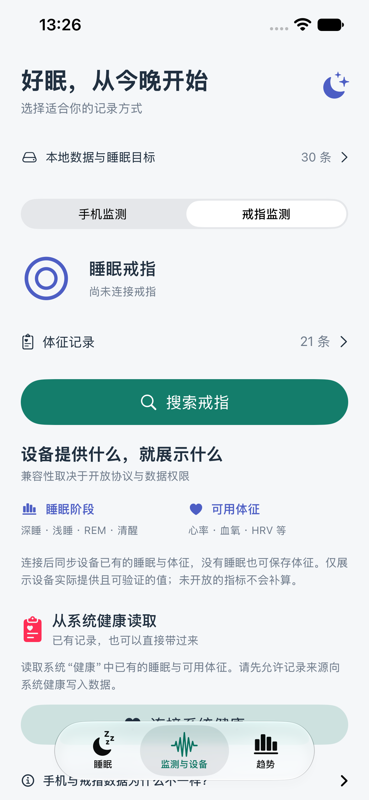
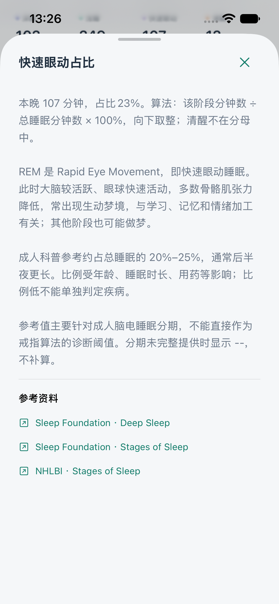
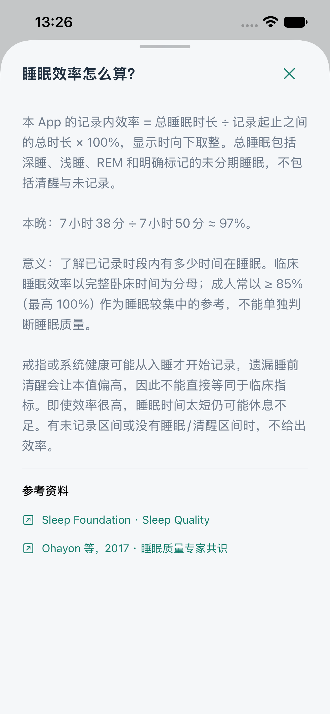

# tongshusleep · SleepGrove

**0.5.6（32）**：安装并应用 UI UX Pro Max 指南，以现有主题变量统一简洁中性底色、按钮、输入框和标题；保留三套外观与睡眠图表颜色。移除设备绑定凭证导入入口。睡眠页与体征详情新增同设备体温范围图、最近值和日期查看，无记录不补值。见 [变更、样式审计与验证](docs/RELEASE_V056.md)。

**0.5.5（31）**：五讲系列课程分别使用官网提供的独立视频封面，课程列表、详情、播放占位和选集保持一致。兼容服务器旧系列总封面，后台发布新的章节专用封面后优先使用新图。见 [素材来源与验证](docs/RELEASE_V055.md)。

**0.5.4（30）**：PSQI 结果补齐历史曲线、分项对照和官网睡眠顾问入口；课程系列逐节展示封面与播放入口。呼吸引导优先使用已安装的高质量中文女声，产品介绍改为带封面的内嵌视频，支持全屏横屏。全局按钮、内容卡片和输入框统一渐变、细边框、柔和层次与按压反馈，保留现有布局与健康功能。见 [版本、验证与真机试听说明](docs/RELEASE_V054.md)。

**0.5.3（29）**：移除 AIS 自评入口、填写页面及新上传字段，旧本地元数据兼容保留。PSQI 18 道题均增加原创卡通小枕头插画和不同主题场景，按题切换配色；答题导航固定在底部，适配深色与动态字体。见 [版本与验证说明](docs/RELEASE_V053.md)。

**0.5.2（28）**：科普增加 PSQI 18 项原生自测、七维计分和本机历史；AIS 保留。呼吸练习增加中文轻声引导，与 4/7/8 秒阶段共用计时。24 种合成声音全部配图列出，支持直接切换，播放、停止、音量和定时前置。课程改为单列，产品购买前置并增加官方使用说明和参数；主要页面采用珊瑚、薰衣草、薄荷与暖黄色。年龄计算保持真实规则，不人为压低。见 [使用、验证和边界](docs/RELEASE_V052.md)。

**0.5.1（27）**：呼吸练习增加轻柔阶段提示音、试听和音量控制；睡眠阶段轨迹移到当晚摘要前，体征图表先于参考说明。掌心安睡仪新增官方实物图、产品介绍及原生视频。BIO 有效估算体温进入本地体征、夜间图表和原有账号同步链路；后台体温窗口需 WorkBuddy 部署对应 Web main。见 [版本说明与真机验收](docs/RELEASE_V051.md)。

**0.5.0（26）改版分支**：英文显示名 SleepGrove，同一 App、Bundle ID 与本地数据不变。按会议方案调整为睡眠、科普、助眠、掌心安睡仪、用户中心五个分区；监测、趋势和健康整合为睡眠首页入口。增加首页 7/30 天图表、活动与恢复摘要、呼吸提示音和 24 种明确标注的合成音色。保留设备同步、系统健康、账号、自动上传、原生课程与京东外链。自动后台录音和未经验证的“没睡”判断不实现。见 [改版、运行与验收说明](docs/SLEEPGROVE_V050.md)。

**0.4.4（25）**：保留首页每日内容、晚安卡、真实睡眠摘要和课程推荐；补齐通知前台展示、冷启动与登录后继续跳转。账号新增 Keychain 安全续期，断网恢复保留凭证。Web 新增明确的“立即推送”和服务内定时扫描。新版接口需要 WorkBuddy 部署；当前免费 Personal Team 不支持远程推送签名，真实 APNs 送达尚未验证，不能把本地提醒当作 Web 推送成功。见 [配置、部署与验证说明](docs/NOTIFICATIONS_LOGIN_V044.md)。

**0.4.3（24）**：修复课堂长期停留在旧目录的问题，进入课堂及前台停留时按 60 秒间隔检查更新，增加刷新按钮和平台更新时间。自动同步先核对当前服务器记录，缺失的已确认记录自动补传，保持原幂等版本；趋势步数仅保留蓝牙设备和系统健康。已与实际部署联调，手机取得线上测试内容，11 月 17、18 日真实睡眠已补传并由 Web 回读确认。见 [修复、实测与操作说明](docs/RELEASE_V043.md)。

**0.4.2（23）**：点击课程封面直接播放第一节，支持课程选集、横屏与恢复竖屏；课堂返回前台按现有间隔检查更新。新增视频和京东商品在本平台后台发布后，App 下拉刷新即可显示，无需重新打包；只上传 CDN 文件不会自动创建课程。见 [本版说明](docs/RELEASE_V042.md) 和 [给 WorkBuddy 的发布提示词](https://github.com/Rocgrey/sleep_tongshu_web/blob/main/docs/WORKBUDDY_CLASSROOM_V042.md)。

**0.4.1（22）**：按现有预览稿统一清新底色、青绿主色与页面表面；课程直接播放完整视频，移除旧平台的 60 秒暂停及授权提示。加入已核实的京东商品图片直达、后台整理健康同步与内容目录初始化状态。见 [升级与验证说明](docs/RELEASE_V041.md)。下方 0.4.0 等条目为历史，不代表目前仍限制试看。

**0.4.0（21），原 App 升级（2026-11-20）**：仍是同一个 sleeptongshu，同一 Bundle ID、两个原 GitHub 仓库和原 WorkBuddy 后台。增强功能已整合到 main，不另建 App。新增原生睡眠课堂、课程章节与本机进度、三套外观、短信／邮件验证码找回、晚安卡、4-7-8 呼吸、定时白噪音、本地提醒和自愿保存的候选语音。Web 由 WorkBuddy 审查部署，本机不操作生产。见 [版本升级与部署说明](docs/RELEASE_V040.md) 和 [功能说明](docs/ENHANCEMENT_20261120.md)。下方日期条目保留为历史。

**验证码找回对接（11 月 20 日）**：已核对最新后端及线上 OpenAPI，按手机号短信／邮箱邮件二选一接入，保留重发倒计时、错误处理和成功后重新登录。真实短信和邮件收取仍需使用本人账号真机验收，未发送测试短信冒充成功。见 [对接说明](docs/WORKBUDDY_EMAIL_RECOVERY.md)。

**登录后闪退修复（11 月 18 日）**：修复普通工程未启用 ARC 时，BIO 本机算法返回已释放结果导致的崩溃。普通和戒指工程共用内存管理配置，结果和错误信息在内部临时对象释放后仍保持有效，增加编译保护和内存回归测试。见 [原因与验证](docs/LOGIN_CRASH_20261118.md)。

**BIO 新日期漏读修复（11 月 17 日）**：历史目录按设备记录时间选择，不再把最大的包序号当作最新日期，避免循环存储回绕后漏读新夜晚。保留读取上限、原算法和图表，接入报告显示实际历史日期并保存原目录用于核对。需重连设备补读；是否能恢复指定夜晚取决于设备保留的输入。见 [原因与验证](docs/BIO_HISTORY_DATES_20261117.md)。

**睡眠日期切换优化（11 月 15 日）**：夜间体征汇总按记录缓存，数据改变后重新计算；减少重复扫描、日期格式器初始化与首屏之外的图表构建，切换日期时重置对应图表状态。保留原始采样和原有同步口径，见 [原因、验证和真机检查](docs/SLEEP_DATE_PERFORMANCE_20261115.md)。

**BIO 本机睡眠计算（11 月 15 日）**：已接入新厂家包的 `IVSleep.a`，在 iPhone 本地使用两天健康/睡眠输入及 RRI 计算阶段，不再依赖云算法配置。真机已用真实历史生成多晚深睡、浅睡、快速眼动和实际返回的清醒阶段，更新原有睡眠图表、夜间体征与账号同步。缺失阶段不补造；SDK 安装、计算规则和实测范围见 [本机睡眠说明](docs/BIO_LOCAL_SLEEP.md)。

**此前 BIO 云端分析核对（11 月 15 日）**：修复最后一次读取为空时漏用本机历史输入的问题，后台合并同设备、同账号记录并按日期展示分析状态。当时云端返回 503“厂家睡眠算法尚未在平台配置”；当前已改为上方的本机优先计算。旧云路径的后端配置及测试保留在 [BIO 睡眠分析说明](docs/BIO_SLEEP_ANALYSIS_20261115.md)。

**睡眠课堂（11 月 14 日）**：底部新增“睡眠课堂”，在 App 内访问线上课堂，支持返回、前进、刷新、网络失败重试及浏览器打开。首次进入才加载网页，切换标签不重复请求。普通工程、戒指工程构建及小屏幕真实网站集成测试通过。见 [操作与网址配置](docs/SLEEP_CLASSROOM.md)。

**流畅度优化（11 月 13 日）**：BIO 收包进度合并刷新，历史报告保存、恢复、解码与上传编码移至后台；已上传文件跳过重复解码，睡眠图表复用本地解析缓存。176 项单元测试（跳过 1 项）及两项图表界面测试通过，已构建并安装至测试 iPhone。见 [原因、修改与验证范围](docs/PERFORMANCE_20261113.md)。

**BIO 自动原始采集（11 月 12 日）**：连接并识别 BIO 后自动逐类采集约 20 秒，实时包分批上传；历史读取结束后自动上传完整接入报告，与 Web 新版会话/信号浏览接口对齐。新增账号归属隔离、历史原文补传和回执保存。实测旧报告包含 133 个 BIOZ 实时包、2870 个健康与睡眠输入包、134 个 RRI 包、7 个心电包；已在本地 Web 验证解析和图表，不冒充线上接收。见 [操作、原始数据范围和验证](docs/BIO_AUTOMATIC_RAW_UPLOAD.md)。下方单次采集开关的说明为旧版行为。

**BIO 原始信号验证**：设备接入新增默认关闭、单次生效的短时原始采集，保存 ACC（16）和 BIOZ（512）原始包及 Protobuf 内容，支持本机图表和账号自动同步。512 是生物电阻抗，不是 PPG。Web 新增独立原始数据归档、图表及下载，Android 接收格式仍需用 IWBle 实际请求确认。见 [截图分析、操作和验证](docs/BIO_RAW_SIGNAL_REVIEW.md) 与 [给 WorkBuddy 的完整部署提示词](docs/WORKBUDDY_RAW_SENSOR_PROMPT.md)。

**BIO 夜间记录与自动同步**：真实体征按日期保存为夜间观测，展示实际均值、采样次数和散点图；厂家返回有效分期后自动更新现有睡眠图表。不以原始输入推算深睡、浅睡或快速眼动。移除“上传这晚睡眠”按钮，真实睡眠、步数和设备体征默认自动同步到当前账号，可在个人页关闭。AIS 可通过“睡眠自评”独立填写并随记录同步。Web 增加幂等接口和设备夜间/全天体征展示，需部署对应更新；厂商云算法仍待真实设备归属及账号权限确认。详见 [功能、接口和验证](docs/BIO_SLEEP_AUTO_SYNC.md)。

**设备睡眠与步数**：睡眠页默认优先展示“监测与设备”已经保存的真实设备记录，无需先读取系统健康。新增设备当天步数、7/30 天累计、有效日均和趋势，沿用原有统计图表；设备、系统健康和账号云端步数分别查看。BIO 只有睡眠原始输入时不生成分期，最近体征单独展示。规则及操作见 [设备睡眠首页与步数统计](docs/DEVICE_SLEEP_STEPS.md)。

睡眠同书，一个用 SwiftUI 编写的本地优先 iOS 睡眠 App。当前版本 **0.4.3（24）** 保留手机号密码注册与登录、可选邮箱、已有邮箱账号登录、JWT Bearer、钥匙串记住登录、启动校验、统一 401 退出和健康记录自动同步。趋势页包含蓝牙设备与系统健康步数的累计、有效日均和图表；账号同步在后台独立进行。保留 19 类系统健康记录、手机监测、设备自动同步与原有睡眠图表。第一版保存在 `v0.1.0` 标签。

**0.3.6 更新**：已核对最新后端仓库与线上 OpenAPI。手机号账号不需要邮箱；账号步数按真实接口上传并回读，同日累计更新不会相加，缺失日期不冒充 0 步。移除 ISI，保留 AIS，旧响应中的多余字段兼容忽略。配置服务地址、文件清单、请求字段及自测步骤见 [当前对接说明](docs/AUTH_STEPS_V036.md)。统一地址在 `Configuration/Service.xcconfig`；部署网关的本机访问配置不提交到 GitHub。App 改动仅推送到 `Rocgrey/tongshusleep`。

**系统睡眠读取增强**：健康页和睡眠页统一使用“从系统健康读取”，一次只读最近 90 天获准访问的睡眠、活动和体征，不再另设睡眠读取按钮；共用读取状态及本地报告。读取结果分别显示睡眠和仅卧床段数，以及最近实际睡眠日期。区分卧床、未分期和真实阶段，保留午睡，不拼接不同来源的重叠分期。重复刷新对账更新，系统中已不可见的导入移入归档并保留备注。系统睡眠不生成 App 参考分；登录并启用自动同步后按当前同步设置上传。7/30 天趋势按睡眠结束日汇总夜间睡眠及午睡，支持阶段点击详情和系统深色外观。读取规则见 [系统睡眠使用与验证说明](docs/SYSTEM_SLEEP_IMPORT.md)，当前上传行为以 [自动同步说明](docs/BIO_SLEEP_AUTO_SYNC.md) 为准。

**加密手环接入测试**：复用现有蓝牙搜索与设备记忆，导入已有绑定凭证后自动认证、读取历史文件，保存明确的设备睡眠分期、有效体征及不重复累计的每日步数。凭证仅存本机钥匙串，不联网登录厂商账号；没有凭证不伪造成功。10 Pro NFC 尚未真机验证，当前手机也未提供可用的配套 App 文件夹，详见 [接入范围、操作与限制](docs/ENCRYPTED_BAND_INTEGRATION.md)。BIO 实测核对见 [11 月 11 日报告分析](docs/BIO_REPORT_20261111.md)。

**BIO 电量和体征修复**：根据实际 BIO9 / 103 固件返回修正电量百分比；按厂家示例转换历史时间、HRV 单位，保存有效心率、血氧、血压、HRV 和压力，体征页优先选择当前设备。健康历史扩大为跨目录分段读取，修复通知已开启时重新读取不启动的问题。原始睡眠输入不冒充睡眠分期，波形拒绝状态如实保留。详见 [依据、范围和测试步骤](docs/BIO_DATA_READ_FIX.md)。

**0.3.0 更新**：读取状态、最近数值及数据日期提前展示；身体年龄资料清单；健康权限和配套 App 写入步骤；健康详情日值统计与记录覆盖图；睡眠阶段环图和作息时间图。心跳间隔验证从最多 8 包扩大至最近一个目录块最多 288 包，报告保留请求序号，便于检查夜间覆盖。详见 [健康页面与整夜验证说明](docs/HEALTH_AND_OVERNIGHT_V030.md)。

**0.3.1 更新**：刷新前检查 HealthKit 授权请求状态，读取过程在原页显示进度并保留已有数据；新增探索性健康年龄，按最近完整同日数据计算，明确未经验证且不是医学年龄。详见 [健康刷新与探索年龄说明](docs/HEALTH_AGE_REFRESH_V031.md)。

**0.3.2 更新**：刷新完成后比较前后记录，在当前健康页明确提示新增数据或“暂时没有新的数据可以更新”；说明最大摄氧量会从系统健康读取，但需要设备或配套 App 写入。详见 [健康刷新结果说明](docs/HEALTH_REFRESH_V032.md)。

系统健康统一读取最近 90 天获准访问的 19 类记录，无需逐项选择设备。配套 App 必须支持并实际写入系统健康；蓝牙连接本身不会让数据自动出现在系统健康。身体年龄包括规则公开、尚未验证的实验估算和单独的心肺研究参考。活动与能量采用系统日统计，睡眠每晚自动采用一份记录，体征汇总可用样本。

**0.3.3 更新**：增加步行跑步距离、活动能量、静息能量、身高、体重指数、体脂率、体重和体能训练记录。更新按钮不再触发已有快照的授权流程，新增“允许更多读取项目”。详见 [扩展健康记录与展示说明](docs/HEALTH_RECORDS_V033.md)。

**0.3.4 更新**：健康页统一“从系统健康读取”按钮，当前权限集合完成申请后不重复弹授权；最新数据仅显示原页提示。新增账号密码登录、注册与钥匙串会话。Web 仓库目前为空且未部署，App 不伪造注册成功；配置 `SLEEP_API_BASE_URL` 为 HTTPS API 前缀后启用正式登录。详见 [本次功能说明](docs/HEALTH_ACCOUNT_V034.md) 与 [给 Web 平台的账号接口约定](docs/ACCOUNT_API_V034.md)。账号接入不包含健康数据上传。

**0.2.8 更新**：底部“健康”页只读最近 90 天的 11 项系统健康记录，提供图表、设备切换、两周变化及长期心肺变化。身体年龄当前仅为最大摄氧量换算的探索性“心肺参考年龄”，有研究表和完整说明；不输出缺乏依据的全身生物年龄或衰老速度。详见 [健康页面、算法与测试步骤](docs/HEALTH_OVERVIEW_V028.md)。新增 HR802 戒指的 SDK 文档确认存在候选 PPI 接口，仍需厂家 SDK 和实测，详见 [文档核对](docs/AIZO_HR802_SDK_REVIEW.md)。

**0.2.7 更新**：连接后自动检查新设备的数据通道，查询型号、电量、步数及八类历史数据，保存本地 JSON 接入报告。支持记录 BPH6、H02C/H102C、BIO 的用户提供版本，逐台实测兼容性；尚不宣称这些型号已经读通。历史信号不擅自转换成睡眠阶段，原戒指路径保留。详见 [新设备测试步骤与边界](docs/WEARABLE_PROBE_V027.md)。

**初次启动的 30 晚记录仍明确标注为示例，与真实记录分开统计。手机声音/体动只做实验性睡眠估算，不生成深睡、REM 或体征。戒指版使用设备 SDK 读取实际记录，未测得的数据不补算。用户提供的设备验证报告已包含设备返回的睡眠阶段与有效体征；尚未取得可用于自主睡眠分期的原始信号。**

**[0.2.4 界面与体征说明](docs/PLAIN_VITALS_V024.md)** 包含三种图表和参考值适用范围。睡眠算法沿用 [0.2.3 公式](docs/RING_AND_METRICS_V023.md)，App 说明改为短句，参考资料只显示文章名和作者。账号功能以 0.3.6 对接说明为准。普通工程和戒指工程均启用系统健康读取；iPhone 签名需要支持 HealthKit 的描述文件。

**0.2.5 更新**：设备检测新增可开启的“设备数据验证”，正常自动同步后尝试逐次心跳历史读取，检查历史字段并被动观察脉搏波回调。报告含接口结果、候选信号图、字段解释和本地文件导出；没有收到信号时不补造波形，也不认定设备不支持。详见 [设备数据验证与测试步骤](docs/DEVICE_SIGNAL_VALIDATION_V025.md)。

**0.2.6 更新**：日常设备页默认收起诊断内容；原始信号验证改为单次开启，避免旧开关使每次连接额外等待。旧体征文件中的无效值也不进入图表与体征导出，原文件保留。诊断报告补全数字文本范围与常见字段解释。详见 [日常同步与数据过滤](docs/EVERYDAY_SYNC_V026.md)。

**0.2.4 更新**：“设备检测 / 搜索蓝牙”；移除血糖、血脂和尿酸等估计项目；体征页新增每日高低范围与数值分布图，每项解释含义和适用参考。不为未知算法的 HRV、压力编造正常范围。命名调整不改变实际协议兼容范围，目前主要验证的仍是 L03 戒指。

构建 8：搜索列表显示附近 BLE 设备的实际名称；无名称时显示“未命名蓝牙设备”。连接受支持的戒指后自动读取电量，以电量条及百分比展示；只返回格数时按格数显示。同步结束断开后保留本次电量，并注明读取时间。详见 [蓝牙名称与设备电量](docs/BLUETOOTH_NAMES_BATTERY.md)。

**戒指版 0.2.3**：设备入口仅面向戒指，隐藏其他类型的旧连接快捷记录。连接并识别受支持的戒指通道后自动同步，没有手动同步按钮；同步结束释放连接，需要再次读取时点击已记忆戒指重连。新增深睡/浅睡/REM 占比、含义、参考与文献链接，以及记录内睡眠效率和自定义参考分的完整算法。报告暂不展示平均呼吸率。真机读取使用 `sleeptongshu-Ring.xcodeproj`，首次检出先运行 `scripts/setup-veepoo.py`。旧版资料见 [0.2.2 说明](docs/DEVICE_SYNC_V022.md) 和 [戒指工程](docs/L03_RING_TEST.md)。

<p>
  
  
  
</p>

以上为 0.2.3 的实际 iPhone 模拟器截图，数值为界面测试示例与预览记录，不是用户的真实体征。历史截图保留在 `docs/screenshots/`。验证结果见 [第二版验证](docs/VALIDATION_V2.md)。

## 界面与功能

- 监测：手机 / 设备两种方式；手机采集开始、结束、保存、舍弃；30 秒本地草稿检查点，异常退出后恢复已有信号。
- 监测入口：“监测与设备”统一放置手机监测与蓝牙连接；“健康”集中读取系统健康。上方“本地数据与睡眠目标”管理目标、备份、示例和清理，蓝牙仅保留一处。
- 手机报告：声音强度、体动、疑似鼾声/说话时间图；估算入睡和安静窗口，摆放、电量、权限与后台限制说明。默认不保存录音；明确同意后可保存本机候选语音，不将说话直接断言为梦话，不自动上传音频。
- 系统健康：健康页只读最近 90 天的 19 类可用数据，自动汇总并更新睡眠报告；不要求选择设备。缺口/冲突保持“未记录”，睡眠体征严格匹配该晚睡眠的来源与设备。系统授权仍由用户选择允许的项目。
- 睡眠：首页总时长、入睡/起床时间、参考分、睡眠效率、深睡占比、阶段时间轴、健康体征、心率曲线及说明。
- 趋势：最近 7 / 30 天的时长、效率、深睡占比；目标参考线；每日记录详情与单条删除。
- 手动记录：跨夜时间、睡前笔记。不虚构手动记录的阶段、分数或体征，缺失数据展示为 `--`。
- 本地数据：SwiftData 持久化，JSON 备份导入/导出，重复 ID 跳过，示例加载/移除与全部清理确认。
- 蓝牙：扫描显示附近设备的实际名称，连接后保存记录，使用系统缓存标识直接重连，支持忘记设备。独立戒指工程保留匹配戒指的认证、历史读取及有效值保存；两个工程均加入新设备公开协议的有界接入测试。搜索或连接成功不代表支持对应设备的全部数据。体征不冒充睡眠平均值。
- 账号与上传：通过共享 `APIClient` 携带 JWT，自动同步真实睡眠、步数及设备体征；个人页可关闭。新幂等接口保证重复同步更新同一份记录，旧部署缺少能力时保留本地并提示。AIS 总分选填，缺少测量不补造。账号步数仍按当前用户回读，始终与本机数据分开展示。

## 第一次运行

1. 用 Xcode 打开 `sleeptongshu.xcodeproj`，选择 `sleeptongshu` scheme。
2. 选择 iPhone 模拟器，按 `⌘R`。最低系统版本 iOS 17，建议 Xcode 16 或更新版本。本项目开发机使用 Xcode 27.2。
3. 没有模拟器时，在 Xcode → Settings → Components 下载 iOS 运行环境。
4. 也可以选择 **My Mac (Mac Catalyst)**，直接在 Mac 查看同一套 SwiftUI 页面。Mac 预览不能代替 iPhone 蓝牙实测。
5. 使用手机号或已有邮箱账号登录；当前部署需按 [对接说明](docs/AUTH_STEPS_V036.md) 配置本机网关访问码，手机构建的本机配置不提交 Git。预览记录始终标记为示例，可在“监测与设备 → 本地数据与睡眠目标”移除；示例不能上传。

### iPhone 真机

在项目的 **Signing & Capabilities** 中选择自己的 Team，必要时把 Bundle Identifier 改成自己的唯一值。连接并信任 iPhone，在设备上开启开发者模式，再选择该 iPhone 运行。工程保留了当前项目所有者的 Team 设置；其他开发者需改成自己的 Team。真机戒指同步请选择 `sleeptongshu-Ring.xcodeproj`，并使用支持 HealthKit 的描述文件；SDK 不支持模拟器或 Mac Catalyst。

### 命令行

若 Xcode 位于“下载”而 `xcode-select` 仍指向 Command Line Tools，可只为当前终端设置：

```sh
export DEVELOPER_DIR="$HOME/Downloads/Xcode.app/Contents/Developer"
```

根据实际安装位置修改上面的路径。之后执行：

```sh
# 构建 iOS，不需要付费账号或签名证书
xcodebuild -project sleeptongshu.xcodeproj -scheme sleeptongshu \
  -destination 'generic/platform=iOS Simulator' \
  -derivedDataPath work/DerivedData CODE_SIGNING_ALLOWED=NO build

# Mac 上测试同一套代码
xcodebuild -project sleeptongshu.xcodeproj -scheme sleeptongshu \
  -destination 'platform=macOS,variant=Mac Catalyst' \
  -derivedDataPath work/Catalyst CODE_SIGN_IDENTITY=- ENABLE_HARDENED_RUNTIME=NO test

# 使用已有 iPhone 模拟器时，将名称替换为 Xcode 中实际设备名称
xcodebuild -project sleeptongshu.xcodeproj -scheme sleeptongshu \
  -destination 'platform=iOS Simulator,name=iPhone 17 Pro' test
```

## 代码结构

| 文件 | 作用 |
| --- | --- |
| `SleepTongshuApp.swift` | 应用入口、本地容器、视觉常量、首次示例初始化 |
| `SleepModels.swift` | 记录、分期、体征、校验、备份格式、未来同步协议 |
| `SleepDashboardView.swift` | 睡眠看板、趋势、记录详情 |
| `SleepCharts.swift` | 时间轴、心率与趋势图 |
| `SleepEditorView.swift` | 手动跨夜记录 |
| `RingScanner.swift` | 蓝牙扫描、连接、记忆、标准特征及数据通道分流 |
| `WearableProbeClient.swift` | 新设备查询、限量历史读取、本地验证报告 |
| `WearableProbeView.swift` | 接入结果、电量、步数、心率预览与报告分享 |
| `SleepMetricGuide.swift` | 指标公式、参考范围、来源说明与文献链接 |
| `LocalDataView.swift` | 本地数据与睡眠目标子页面，无蓝牙扫描 |
| `MonitoringView.swift` | 双模式监测、使用指南、手机报告与信号图 |
| `PhoneSleepMonitor.swift` | 麦克风、系统声音分类、加速度与本地检查点 |
| `PhoneSleepData.swift` | 手机分钟窗口与透明的实验性估算规则 |
| `HealthSleepImporter.swift` | 自动选取每晚记录、分期归一化与重复导入更新 |
| `HealthOverviewStore.swift` | 统一读取系统健康、每日统计、本机快照与刷新 |
| `HealthOverviewView.swift` | 身体状态、心肺参考年龄、长期变化、健康图表 |
| `FitnessAge.swift` | FRIEND 实测参考表、适用条件、透明的探索性换算 |
| `Configuration/` | 后台音频声明、权限文字、HealthKit 与戒指构建配置 |
| `sleeptongshuTests/` | 数据一致性、导入验证与持久化测试 |
| `sleeptongshuUITests/` | 日期、趋势、详情、手动记录与清理操作测试 |

更多说明：[数据与蓝牙](docs/DATA_AND_BLUETOOTH.md)、[测试步骤](docs/TESTING.md)、[L03 Ultra / G Band 日志分析](docs/GBAND_LOG_ANALYSIS.md)。日志分析之后已接入 SDK 并验证真实戒指认证；完整睡眠与体征一致性尚待实际记录核对。

## 说明

参考分是自定义指标：时长得分 × 60% + 睡眠效率 × 40%，时长以 8 小时封顶。它不是小米或 Apple 的评分，也不是医疗结论。阶段分期和体征需要真实数据来源支持；App 不从心率推算血氧或呼吸率。示例图形与示例统计使用同一份时间段数据。

本地数据库位于 App 沙盒。删除 App 可能删除本地记录，请先导出备份。备份包含健康数据，保存和分享位置由你决定。当前关闭 CloudKit；账号健康记录同步沿用个人页设置，候选语音不自动上传。

## 戒指兼容范围

当前主要验证 L03 Ultra 的设备通道。其他戒指需要独立验证型号、固件、认证和历史数据协议；仅名称包含 ring 不代表已适配。扫描识别不到名称或公开服务的戒指可能不显示，需要补充设备资料；不承诺任意蓝牙戒指都能读取睡眠。系统健康导入与戒指直连是独立来源，分别统计。
