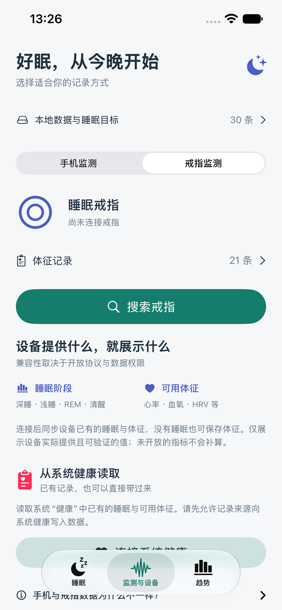
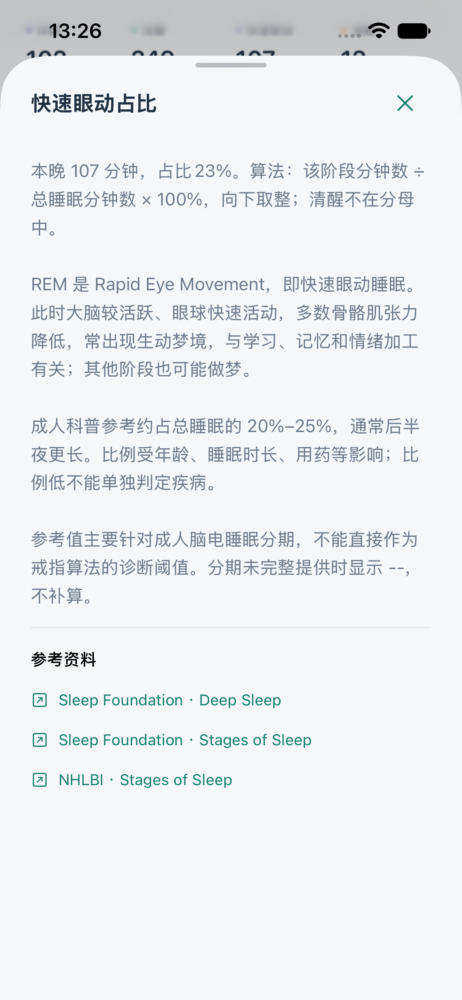
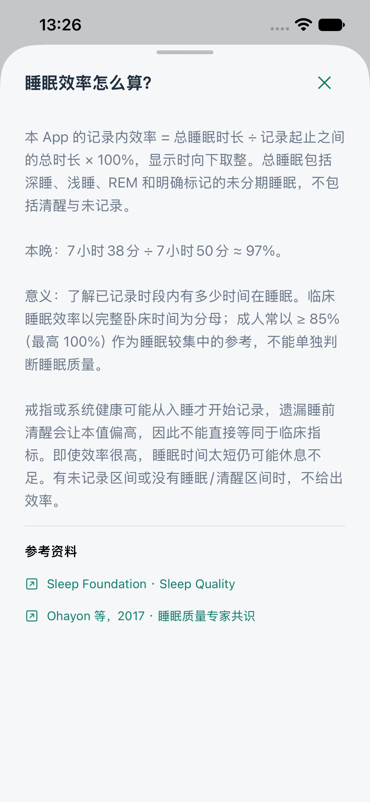

# tongshusleep · sleeptongshu

睡眠同书，一个用 SwiftUI 编写的本地优先 iOS 睡眠 App。当前版本 **0.2.4（6）** 保留手机监测、设备自动同步与系统健康导入。第一版保存在 `v0.1.0` 标签。

**初次启动的 30 晚记录仍明确标注为示例，与真实记录分开统计。手机声音/体动只做实验性睡眠估算，不生成深睡、REM 或体征。戒指版使用设备 SDK 读取实际记录，未测得的数据不补算。用户已反馈真实戒指有 35 条有效体征；过夜睡眠仍需实际记录对照。**

**[0.2.4 界面与体征说明](docs/PLAIN_VITALS_V024.md)** 包含最新变化、三种图表和参考值适用范围。睡眠算法沿用 [0.2.3 公式](docs/RING_AND_METRICS_V023.md)，App 说明改为短句，参考资料只显示文章名和作者。当前无 App 自建账号或服务器。普通工程和戒指工程均启用系统健康读取；iPhone 签名需要支持 HealthKit 的描述文件。

**0.2.4 更新**：“设备检测 / 搜索蓝牙”；移除血糖、血脂和尿酸等估计项目；体征页新增每日高低范围与数值分布图，每项解释含义和适用参考。不为未知算法的 HRV、压力编造正常范围。命名调整不改变实际协议兼容范围，目前主要验证的仍是 L03 戒指。

构建 8：搜索列表显示附近 BLE 设备的实际名称；无名称时显示“未命名蓝牙设备”。连接受支持的戒指后自动读取电量，以电量条及百分比展示；只返回格数时按格数显示。同步结束断开后保留本次电量，并注明读取时间。详见 [蓝牙名称与设备电量](docs/BLUETOOTH_NAMES_BATTERY.md)。

**戒指版 0.2.3**：设备入口仅面向戒指，隐藏其他类型的旧连接快捷记录。连接并识别受支持的戒指通道后自动同步，没有手动同步按钮；同步结束释放连接，需要再次读取时点击已记忆戒指重连。新增深睡/浅睡/REM 占比、含义、参考与文献链接，以及记录内睡眠效率和自定义参考分的完整算法。报告暂不展示平均呼吸率。真机读取使用 `sleeptongshu-Ring.xcodeproj`，首次检出先运行 `scripts/setup-veepoo.py`。旧版资料见 [0.2.2 说明](docs/DEVICE_SYNC_V022.md) 和 [戒指工程](docs/L03_RING_TEST.md)。

<p>
  
  
  
</p>

以上为 0.2.3 的实际 iPhone 模拟器截图，数值为界面测试示例与预览记录，不是用户的真实体征。历史截图保留在 `docs/screenshots/`。验证结果见 [第二版验证](docs/VALIDATION_V2.md)。

## 界面与功能

- 监测：手机 / 戒指两种方式；手机采集开始、结束、保存、舍弃；30 秒本地草稿检查点，异常退出后恢复已有信号。
- 合并入口：底部“监测与设备”统一放置手机、戒指和健康读取；上方“本地数据与睡眠目标”管理目标、备份、示例和清理，蓝牙仅保留一处。
- 手机报告：声音强度、体动、疑似鼾声/说话时间图；估算入睡和安静窗口，摆放、电量、权限与后台限制说明。不保存原始录音，不将说话直接断言为梦话。
- 系统健康：只读最近 30 天的睡眠与可用体征，选择单一来源/设备导入，同一来源同一晚更新而非重复创建；缺口/冲突保持“未记录”。读取仍需用户在系统权限弹窗中授权。
- 睡眠：首页总时长、入睡/起床时间、参考分、睡眠效率、深睡占比、阶段时间轴、健康体征、心率曲线及说明。
- 趋势：最近 7 / 30 天的时长、效率、深睡占比；目标参考线；每日记录详情与单条删除。
- 手动记录：跨夜时间、睡前笔记。不虚构手动记录的阶段、分数或体征，缺失数据展示为 `--`。
- 本地数据：SwiftData 持久化，JSON 备份导入/导出，重复 ID 跳过，示例加载/移除与全部清理确认。
- 戒指：确认支持的戒指通道后保存设备标识、通用名称与时间，使用系统缓存标识直接重连，支持忘记设备。扫描按戒指名称/公开服务与已确认标识筛选，不列出通用手环或手表。独立戒指工程使用官方 SDK 进行匹配戒指的认证、历史读取及有效值保存；通用工程供界面与标准特征开发。体征不冒充睡眠平均值。
- 同步扩展：`SleepSyncClient` 使用 Codable 值类型预留异步上传/下载接口，当前没有服务端、账号或网络同步。

## 第一次运行

1. 用 Xcode 打开 `sleeptongshu.xcodeproj`，选择 `sleeptongshu` scheme。
2. 选择 iPhone 模拟器，按 `⌘R`。最低系统版本 iOS 17，建议 Xcode 16 或更新版本。本项目开发机使用 Xcode 27.2。
3. 没有模拟器时，在 Xcode → Settings → Components 下载 iOS 运行环境。
4. 也可以选择 **My Mac (Mac Catalyst)**，直接在 Mac 查看同一套 SwiftUI 页面。Mac 预览不能代替 iPhone 蓝牙实测。
5. 首次启动载入 30 晚示例；可在“监测与设备 → 本地数据与睡眠目标”移除示例，然后添加自己的记录。

### iPhone 真机

在项目的 **Signing & Capabilities** 中选择自己的 Team，必要时把 Bundle Identifier 改成自己的唯一值。连接并信任 iPhone，在设备上开启开发者模式，再选择该 iPhone 运行。工程保留了当前项目所有者的 Team 设置；其他开发者需改成自己的 Team。真机戒指同步请选择 `sleeptongshu-Ring.xcodeproj`，并使用支持 HealthKit 的描述文件；SDK 不支持模拟器或 Mac Catalyst。

### 命令行

若 Xcode 位于“下载”而 `xcode-select` 仍指向 Command Line Tools，可只为当前终端设置：

```sh
export DEVELOPER_DIR="$HOME/Downloads/Xcode.app/Contents/Developer"
```

根据实际安装位置修改上面的路径。之后执行：

```sh
# 构建 iOS，不需要付费账号或签名证书
xcodebuild -project sleeptongshu.xcodeproj -scheme sleeptongshu \
  -destination 'generic/platform=iOS Simulator' \
  -derivedDataPath work/DerivedData CODE_SIGNING_ALLOWED=NO build

# Mac 上测试同一套代码
xcodebuild -project sleeptongshu.xcodeproj -scheme sleeptongshu \
  -destination 'platform=macOS,variant=Mac Catalyst' \
  -derivedDataPath work/Catalyst CODE_SIGN_IDENTITY=- ENABLE_HARDENED_RUNTIME=NO test

# 使用已有 iPhone 模拟器时，将名称替换为 Xcode 中实际设备名称
xcodebuild -project sleeptongshu.xcodeproj -scheme sleeptongshu \
  -destination 'platform=iOS Simulator,name=iPhone 17 Pro' test
```

## 代码结构

| 文件 | 作用 |
| --- | --- |
| `SleepTongshuApp.swift` | 应用入口、本地容器、视觉常量、首次示例初始化 |
| `SleepModels.swift` | 记录、分期、体征、校验、备份格式、未来同步协议 |
| `SleepDashboardView.swift` | 睡眠看板、趋势、记录详情 |
| `SleepCharts.swift` | 时间轴、心率与趋势图 |
| `SleepEditorView.swift` | 手动跨夜记录 |
| `RingScanner.swift` | 戒指筛选、扫描、连接、记忆和标准只读特征 |
| `SleepMetricGuide.swift` | 指标公式、参考范围、来源说明与文献链接 |
| `LocalDataView.swift` | 本地数据与睡眠目标子页面，无蓝牙扫描 |
| `MonitoringView.swift` | 双模式监测、使用指南、手机报告与信号图 |
| `PhoneSleepMonitor.swift` | 麦克风、系统声音分类、加速度与本地检查点 |
| `PhoneSleepData.swift` | 手机分钟窗口与透明的实验性估算规则 |
| `HealthSleepImporter.swift` | HealthKit 授权、来源选择、分期归一化与导入 |
| `Configuration/` | 后台音频声明、权限文字、HealthKit 与戒指构建配置 |
| `sleeptongshuTests/` | 数据一致性、导入验证与持久化测试 |
| `sleeptongshuUITests/` | 日期、趋势、详情、手动记录与清理操作测试 |

更多说明：[数据与蓝牙](docs/DATA_AND_BLUETOOTH.md)、[测试步骤](docs/TESTING.md)、[L03 Ultra / G Band 日志分析](docs/GBAND_LOG_ANALYSIS.md)。日志分析之后已接入 SDK 并验证真实戒指认证；完整睡眠与体征一致性尚待实际记录核对。

## 说明

参考分是自定义指标：时长得分 × 60% + 睡眠效率 × 40%，时长以 8 小时封顶。它不是小米或 Apple 的评分，也不是医疗结论。阶段分期和体征需要真实数据来源支持；App 不从心率推算血氧或呼吸率。示例图形与示例统计使用同一份时间段数据。

本地数据库位于 App 沙盒。删除 App 可能删除本地记录，请先导出备份。备份包含健康数据，保存和分享位置由你决定。当前关闭 CloudKit，不向服务器发送健康记录。

## 戒指兼容范围

当前主要验证 L03 Ultra 的设备通道。其他戒指需要独立验证型号、固件、认证和历史数据协议；仅名称包含 ring 不代表已适配。扫描识别不到名称或公开服务的戒指可能不显示，需要补充设备资料；不承诺任意蓝牙戒指都能读取睡眠。系统健康导入与戒指直连是独立来源，分别统计。
