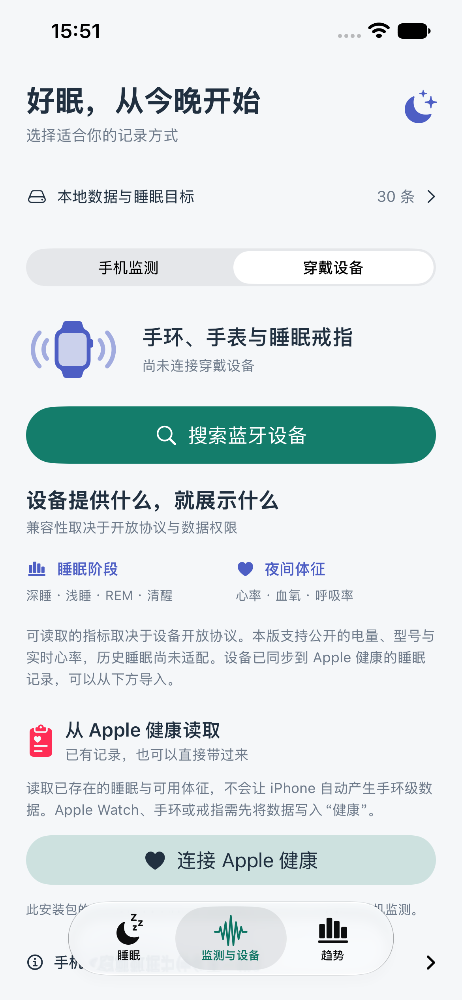
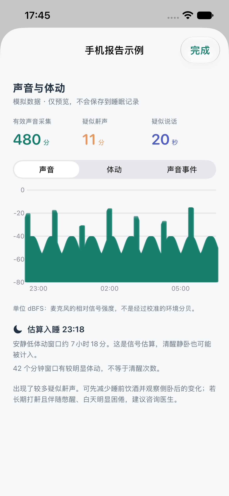
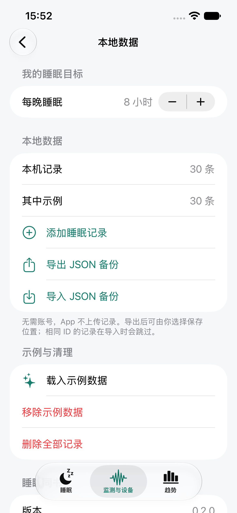

# tongshusleep · sleeptongshu

睡眠同书，一个用 SwiftUI 编写的本地优先 iOS 睡眠 App。当前第二版 **0.2.0** 加入手机监测、Apple 健康导入和通用穿戴设备入口。第一版保存在 `v0.1.0` 标签。

**初次启动的 30 晚记录是明确标注的示例。手机监测可以实际采集麦克风和加速度信号，但睡眠时长只是实验性估算，不生成深睡、REM 或体征。历史穿戴睡眠需通过 Apple 健康或设备专用协议；蓝牙连上不代表可同步睡眠。**

第二版的安装、权限、算法与真机测试步骤见 **[第二版说明](docs/V2.md)**。普通 `sleeptongshu` scheme 保持基础安装能力；`sleeptongshu-Health` scheme 启用 HealthKit，需要对应签名能力。App 不需要小米账号，没有 App 自建账号或服务器。

<p>
  
  
  
</p>

以上为实际 iPhone 模拟器截图，报告预览使用明确标注的模拟信号。第一版截图保留在 `docs/screenshots/`。验证结果见 [第二版验证](docs/VALIDATION_V2.md)。

## 界面与功能

- 监测：手机 / 穿戴设备两种方式；夜间采集开始、结束、保存、舍弃；30 秒本地草稿检查点，异常退出后恢复已有信号。
- 合并入口：底部“监测与设备”统一放置手机、穿戴和健康读取；上方“本地数据与睡眠目标”管理目标、备份、示例和清理，蓝牙仅保留一处。
- 手机报告：声音强度、体动、疑似鼾声/说话时间图；估算入睡和安静窗口，摆放、电量、权限与后台限制说明。不保存原始录音，不将说话直接断言为梦话。
- Apple 健康：只读最近 30 天的睡眠与可用体征，选择单一来源/设备导入，同一来源同一晚更新而非重复创建；缺口/冲突保持“未记录”。默认普通安装不启用此能力，请选择健康 scheme。
- 睡眠：首页总时长、入睡/起床时间、参考分、睡眠效率、深睡占比、阶段时间轴、健康体征、心率曲线及说明。
- 趋势：最近 7 / 30 天的时长、效率、深睡占比；目标参考线；每日记录详情与单条删除。
- 手动记录：跨夜时间、睡前笔记。不虚构手动记录的阶段、分数或体征，缺失数据展示为 `--`。
- 本地数据：SwiftData 持久化，JSON 备份导入/导出，重复 ID 跳过，示例加载/移除与全部清理确认。
- 设备：BLE 扫描、连接、超时、断线和权限状态。连接后检查开放服务，分别展示标准电量、型号和实时心率读取状态；支持重新读取、读取错误提示和诊断分享，不写入私有特征。实时心率不冒充整夜平均心率。解决“连接了但没有数据”见 [蓝牙排查](docs/BLUETOOTH_TROUBLESHOOTING.md)。
- 同步扩展：`SleepSyncClient` 使用 Codable 值类型预留异步上传/下载接口，当前没有服务端、账号或网络同步。

## 第一次运行

1. 用 Xcode 打开 `sleeptongshu.xcodeproj`，选择 `sleeptongshu` scheme。
2. 选择 iPhone 模拟器，按 `⌘R`。最低系统版本 iOS 17，建议 Xcode 16 或更新版本。本项目开发机使用 Xcode 27.2。
3. 没有模拟器时，在 Xcode → Settings → Components 下载 iOS 运行环境。
4. 也可以选择 **My Mac (Mac Catalyst)**，直接在 Mac 查看同一套 SwiftUI 页面。Mac 预览不能代替 iPhone 蓝牙实测。
5. 首次启动载入 30 晚示例；可在“监测与设备 → 本地数据与睡眠目标”移除示例，然后添加自己的记录。

### iPhone 真机

在项目的 **Signing & Capabilities** 中选择自己的 Team，必要时把 Bundle Identifier 改成自己的唯一值。连接并信任 iPhone，在设备上开启开发者模式，再选择该 iPhone 运行。工程保留了当前项目所有者的 Team 设置；其他开发者需改成自己的 Team。普通 scheme 可用于基础个人调试；健康 scheme 需要 HealthKit 对应的开发能力和描述文件。

### 命令行

若 Xcode 位于“下载”而 `xcode-select` 仍指向 Command Line Tools，可只为当前终端设置：

```sh
export DEVELOPER_DIR="$HOME/Downloads/Xcode.app/Contents/Developer"
```

根据实际安装位置修改上面的路径。之后执行：

```sh
# 构建 iOS，不需要付费账号或签名证书
xcodebuild -project sleeptongshu.xcodeproj -scheme sleeptongshu \
  -destination 'generic/platform=iOS Simulator' \
  -derivedDataPath work/DerivedData CODE_SIGNING_ALLOWED=NO build

# Mac 上测试同一套代码
xcodebuild -project sleeptongshu.xcodeproj -scheme sleeptongshu \
  -destination 'platform=macOS,variant=Mac Catalyst' \
  -derivedDataPath work/Catalyst CODE_SIGN_IDENTITY=- ENABLE_HARDENED_RUNTIME=NO test

# 使用已有 iPhone 模拟器时，将名称替换为 Xcode 中实际设备名称
xcodebuild -project sleeptongshu.xcodeproj -scheme sleeptongshu \
  -destination 'platform=iOS Simulator,name=iPhone 17 Pro' test
```

## 代码结构

| 文件 | 作用 |
| --- | --- |
| `SleepTongshuApp.swift` | 应用入口、本地容器、视觉常量、首次示例初始化 |
| `SleepModels.swift` | 记录、分期、体征、校验、备份格式、未来同步协议 |
| `SleepDashboardView.swift` | 睡眠看板、趋势、记录详情 |
| `SleepCharts.swift` | 时间轴、心率与趋势图 |
| `SleepEditorView.swift` | 手动跨夜记录 |
| `BandScanner.swift` | 通用 BLE 扫描、连接和标准只读特征 |
| `BandConnectionView.swift` | 本地数据与睡眠目标子页面，无蓝牙扫描 |
| `MonitoringView.swift` | 双模式监测、使用指南、手机报告与信号图 |
| `PhoneSleepMonitor.swift` | 麦克风、系统声音分类、加速度与本地检查点 |
| `PhoneSleepData.swift` | 手机分钟窗口与透明的实验性估算规则 |
| `HealthSleepImporter.swift` | HealthKit 授权、来源选择、分期归一化与导入 |
| `Configuration/` | 后台音频声明、权限文字、可选 HealthKit 配置 |
| `sleeptongshuTests/` | 数据一致性、导入验证与持久化测试 |
| `sleeptongshuUITests/` | 日期、趋势、详情、手动记录与清理操作测试 |

更多说明：[数据与蓝牙](docs/DATA_AND_BLUETOOTH.md)、[测试步骤](docs/TESTING.md)。

## 说明

参考分是自定义指标：时长得分 × 60% + 睡眠效率 × 40%，时长以 8 小时封顶。它不是小米或 Apple 的评分，也不是医疗结论。阶段分期和体征需要真实数据来源支持；App 不从心率推算血氧或呼吸率。示例图形与示例统计使用同一份时间段数据。

本地数据库位于 App 沙盒。删除 App 可能删除本地记录，请先导出备份。备份包含健康数据，保存和分享位置由你决定。当前关闭 CloudKit，不向服务器发送健康记录。

## 接下来适配手环

先确认穿戴设备的准确型号及固件，再验证认证和历史数据协议；之后实现 `WearableSleepAdapter`，输出经过校验的 `SleepPayload`。无法直接读取时可使用本版的可选 HealthKit 导入，但设备厂商 App 仍可能要求账号。当前不承诺任意蓝牙设备无需认证即可读取睡眠。
