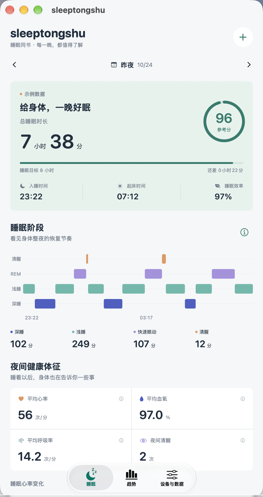
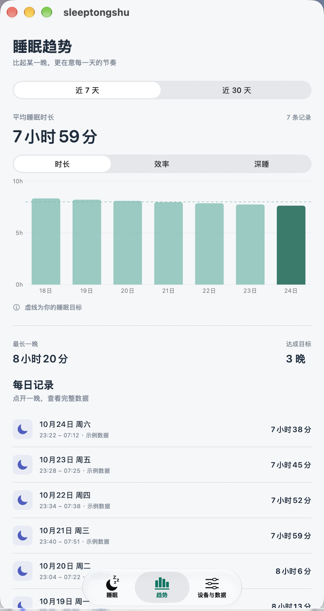

# tongshusleep · sleeptongshu

睡眠同书，一个用 SwiftUI 编写的本地优先 iOS 睡眠 App。第一版先把睡眠数据展示、记录和备份做完整，方便用自己的设备逐步验证。

**当前展示的睡眠、阶段、心率和血氧是明确标注的示例。尚未实现小米手环私有认证及睡眠数据下载，也没有接入 HealthKit。通用蓝牙连接成功不代表能同步睡眠。**

<p>
  
  
</p>

截图为真实 Mac Catalyst 运行结果，使用模拟睡眠数据；并非 iPhone 模拟器截图。

## 界面与功能

- 睡眠：首页总时长、入睡/起床时间、参考分、睡眠效率、深睡占比、阶段时间轴、健康体征、心率曲线及说明。
- 趋势：最近 7 / 30 天的时长、效率、深睡占比；目标参考线；每日记录详情与单条删除。
- 手动记录：跨夜时间、睡前笔记。不虚构手动记录的阶段、分数或体征，缺失数据展示为 `--`。
- 本地数据：SwiftData 持久化，JSON 备份导入/导出，重复 ID 跳过，示例加载/移除与全部清理确认。
- 设备：BLE 扫描、连接、超时、断线和权限状态。设备支持时读取标准电量/型号特征，不写入私有特征。
- 同步扩展：`SleepSyncClient` 使用 Codable 值类型预留异步上传/下载接口，当前没有服务端、账号或网络同步。

## 第一次运行

1. 用 Xcode 打开 `sleeptongshu.xcodeproj`，选择 `sleeptongshu` scheme。
2. 选择 iPhone 模拟器，按 `⌘R`。最低系统版本 iOS 17，建议 Xcode 16 或更新版本。本项目开发机使用 Xcode 27.2。
3. 没有模拟器时，在 Xcode → Settings → Components 下载 iOS 运行环境。
4. 也可以选择 **My Mac (Mac Catalyst)**，直接在 Mac 查看同一套 SwiftUI 页面。Mac 预览不能代替 iPhone 蓝牙实测。
5. 首次启动载入 30 晚示例；可在“设备与数据”移除示例，然后添加自己的记录。

### iPhone 真机

在项目的 **Signing & Capabilities** 中选择自己的 Team（Personal Team 可用于个人调试），必要时把 Bundle Identifier 改成自己的唯一值。连接并信任 iPhone，在设备上开启开发者模式，再选择该 iPhone 运行。工程没有写死其他人的开发者 Team 或证书。

### 命令行

若 Xcode 位于“下载”而 `xcode-select` 仍指向 Command Line Tools，可只为当前终端设置：

```sh
export DEVELOPER_DIR="$HOME/Downloads/Xcode.app/Contents/Developer"
```

根据实际安装位置修改上面的路径。之后执行：

```sh
# 构建 iOS，不需要付费账号或签名证书
xcodebuild -project sleeptongshu.xcodeproj -scheme sleeptongshu \
  -destination 'generic/platform=iOS Simulator' \
  -derivedDataPath work/DerivedData CODE_SIGNING_ALLOWED=NO build

# Mac 上测试同一套代码
xcodebuild -project sleeptongshu.xcodeproj -scheme sleeptongshu \
  -destination 'platform=macOS,variant=Mac Catalyst' \
  -derivedDataPath work/Catalyst CODE_SIGN_IDENTITY=- ENABLE_HARDENED_RUNTIME=NO test

# 使用已有 iPhone 模拟器时，将名称替换为 Xcode 中实际设备名称
xcodebuild -project sleeptongshu.xcodeproj -scheme sleeptongshu \
  -destination 'platform=iOS Simulator,name=iPhone 17 Pro' test
```

## 代码结构

| 文件 | 作用 |
| --- | --- |
| `SleepTongshuApp.swift` | 应用入口、本地容器、视觉常量、首次示例初始化 |
| `SleepModels.swift` | 记录、分期、体征、校验、备份格式、未来同步协议 |
| `SleepDashboardView.swift` | 睡眠看板、趋势、记录详情 |
| `SleepCharts.swift` | 时间轴、心率与趋势图 |
| `SleepEditorView.swift` | 手动跨夜记录 |
| `BandScanner.swift` | 通用 BLE 扫描、连接和标准只读特征 |
| `BandConnectionView.swift` | 设备、目标与本地数据管理 |
| `sleeptongshuTests/` | 数据一致性、导入验证与持久化测试 |
| `sleeptongshuUITests/` | 日期、趋势、详情、手动记录与清理操作测试 |

更多说明：[数据与蓝牙](docs/DATA_AND_BLUETOOTH.md)、[测试步骤](docs/TESTING.md)。

## 说明

参考分是自定义指标：时长得分 × 60% + 睡眠效率 × 40%，时长以 8 小时封顶。它不是小米或 Apple 的评分，也不是医疗结论。阶段分期和体征需要真实数据来源支持；App 不从心率推算血氧或呼吸率。示例图形与示例统计使用同一份时间段数据。

本地数据库位于 App 沙盒。删除 App 可能删除本地记录，请先导出备份。备份包含健康数据，保存和分享位置由你决定。当前关闭 CloudKit，不向服务器发送健康记录。

## 接下来适配手环

先确认手环的准确型号及固件，再验证认证和历史数据协议；之后实现 `SleepPayload` 数据适配器。若无法合法、稳定地直接取得所需数据，可另行实现可选的 HealthKit 导入。当前代码不承诺小米手环无需账号即可完成配对或读取睡眠。
