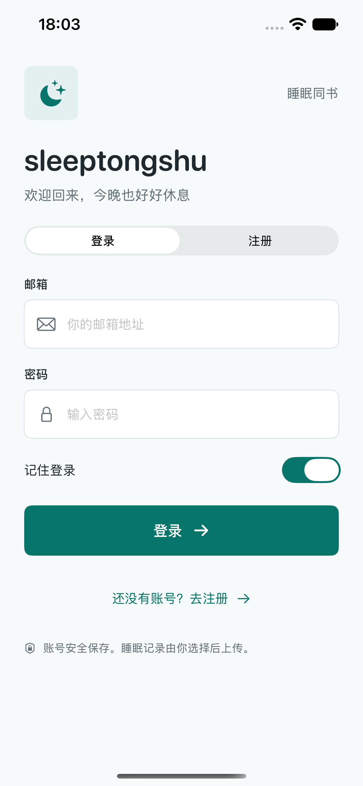
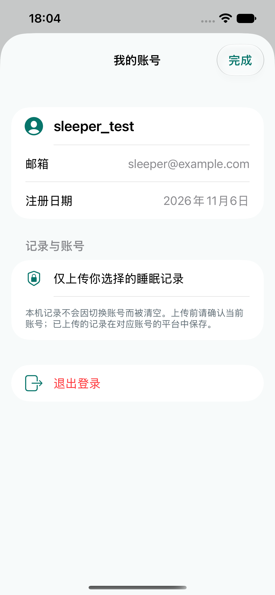
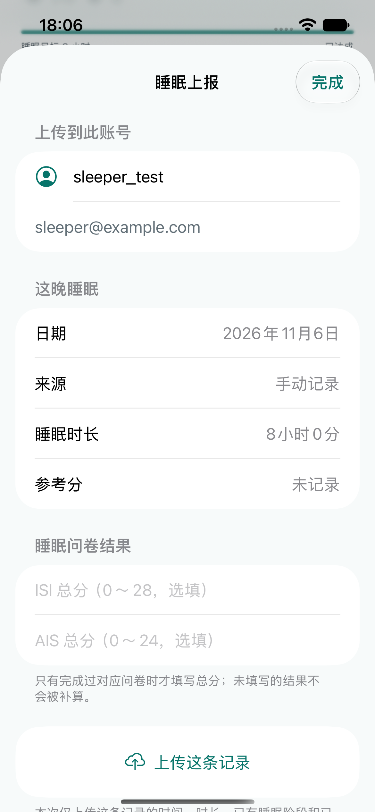

# v1 账号、鉴权与睡眠上报对接：0.3.5（19）

> 历史版本说明。当前手机号登录、账号步数以及问卷字段以 [0.3.6 对接说明](AUTH_STEPS_V036.md) 为准；本文所列旧邮箱必填及 ISI 字段不再用于新版本。

日期：2026-11-06。App 代码仓库为 `Rocgrey/tongshusleep`；`Rocgrey/sleep_tongshu_web` 只读取契约，本次不修改或推送后端代码。

## 核对的契约

已通过 GitHub API 读取后端 `app/schemas/schemas.py`、`app/api/v1/auth.py`、`app/api/deps.py`、`app/api/v1/health.py`，并核对部署服务的 OpenAPI。后端的实际实现比早期约定有少量差异：

| 接口 | App 使用的请求 | 实际响应及处理 |
| --- | --- | --- |
| POST `/api/v1/auth/register` | 仅 `username`、`email`、`password` | 201 `{message}`；不含 token，返回登录页并保留邮箱 |
| POST `/api/v1/auth/login` | 仅 `email`、`password` | `access_token`、`token_type`、`expire_at`；过期时间为 Unix 秒，之后调用 `/auth/me` 校验身份 |
| GET `/api/v1/auth/me` | Bearer token | `id` 为整数，使用 `username`、`email`、`created_at`；实际字段名是 `created_at`，不是 `create_time` |
| POST `/api/v1/auth/logout` | Bearer token，无请求体 | 200 `{message}`；本机清除凭证，服务端将 JWT 拉黑 |
| POST `/api/v1/health/sleep-record` | 使用既有 `SleepRecordCreate` 字段 | 201；检查返回的 `id` 与 `user_id` |

注册用户名遵循后端 3～32 位中文、英文、数字、下划线；不擅自转小写。邮箱去除首尾空白；最终格式验证由后端完成。注册密码 6～72 字符，另外不超过 72 个 UTF-8 字节，避免 bcrypt 截断。登录只检查密码非空，不给已有账号新增长度限制。确认密码不发送给后端。

400/409/422 等错误显示后端 `detail` 或 `message` 原文；FastAPI 校验列表提取每项 `msg`，不显示可能包含密码的 `input`。注册、登录、上传错误均有提示框；健康数据刷新仍保留原页提示，不订阅这些账号错误。

## 修改服务地址

统一修改 [Configuration/Service.xcconfig](../Configuration/Service.xcconfig) 的 `SLEEP_API_BASE_URL`。默认是已部署服务的 `/api/v1` 前缀。xcconfig 中 URL 写成：

```xcconfig
SLEEP_API_BASE_URL = https:/$()/tongshusleep-backend.app.workbuddy.host/api/v1
```

也可复制 [ServiceLocal.example.xcconfig](../Configuration/ServiceLocal.example.xcconfig) 为 `Configuration/ServiceLocal.xcconfig`，在里面覆盖测试地址。该文件已加入 `.gitignore`。Debug、Release、Health 与戒指真机工程都包含同一配置。`APIConfiguration.defaultBaseURL` 只作为未提供构建设置时的后备值。

当前 WorkBuddy 部署有分享链接访问校验。仅在本机配置 `SLEEP_GATEWAY_SHARE_CODE`；本次已为连接手机的构建配置好用户提供的访问码，未提交该码或网关 cookie。App 先访问同域入口获取仅在内存中的网关 cookie，API 路径和 JSON 字段保持不变。请求仍携带标准 `Authorization: Bearer`；仅配置此网关时额外携带后端 `deps.py` 和 `auth.py` 已支持的 `X-Auth-Token`。迁移到直接开放 API 的正式域名时清空访问码即可，不改变用户 JWT 协议。

服务地址必须为 HTTPS，不允许 URL 中包含账号密码、查询参数或片段；不要把完整分享链接作为 baseURL。网关访问配置与用户 JWT 相互独立。网络层拒绝重定向，不自动重试注册或上传 POST。

## 登录状态与路由

勾选“记住登录”时，服务地址、用户基本信息、token、过期时间保存在系统钥匙串，保护级别为 `WhenUnlockedThisDeviceOnly`；不保存密码。关闭时只保留进程内会话并移除已保存的凭证。开关本身可保存在偏好设置中，不包含凭据。

启动恢复先检查服务地址和到期时间，再调用 `/auth/me`，服务确认后才进入业务页；断网时不伪装恢复成功，也不因为暂时断网删除仍可能有效的钥匙串凭据。过期、无效、黑名单等受保护接口的 401 均清除登录状态和本机凭证，回到登录页。普通 403（权限不足）不误判为 token 到期。旧请求的 401 只针对其使用的 token，不能退出后来建立的新会话。

账号状态保存待返回的个人页或睡眠上传页。401 后重新登录会回到该页，不自动重新上传。手动退出不保留待返回页；本机睡眠和体征记录始终保留。前台切回和到期计时也会检查会话。

## 睡眠与问卷衔接

手机采集、设备同步、系统健康读取、SwiftData 备份与原有图表未删除。当前检出的 App 原先只有 `SleepSyncClient` 协议，没有实际 HTTP 上传或 ISI/AIS 问卷实现；本次保留协议，增量增加真实上传入口及已有问卷总分输入，不宣称新增完整问卷。

睡眠看板选择一条非示例记录，点击“上传这晚睡眠”。核对目标账号后上传。只发送当前记录：

- `record_date` 使用睡眠结束日；时间使用后端要求的本地 `yyyy-MM-dd HH:mm:ss` 字符串。
- 总时长、已有参考分、完整且已知的深睡/浅睡/REM 分钟数、可用清醒次数、笔记；缺少阶段时省略，不补零冒充测量。
- `isi_score` 0～28、`ais_score` 0～24，有既有结果才选填，空白不发送；不从睡眠时长反推问卷分。
- 不发送 `user_id`、密码、设备标识、原始传感器或全部系统健康数据；归属由后端 token 决定。没有私自新增扩展字段。

成功回执按“服务地址＋用户 ID＋本机记录 ID”隔离，阻止同一条记录重复点击上传。后端目前只有创建接口，没有更新或幂等键：已上传的本机记录不会自动覆盖平台记录；请求超时或响应丢失时需先到平台核对再手动重试，App 不自动重发。

## 对接自测

1. 手机启动 App，点注册，填写用户名、邮箱、密码、确认密码；注册成功停留在邮箱登录页。平台可看到新用户，不应看到明文密码。
2. 用邮箱登录，勾选“记住登录”，打开健康页右上角“我的账号”，核对邮箱。退出进程再打开，确认调用 `/auth/me` 后自动进入；取消“记住登录”再登录，退出进程后应要求重登。
3. 保存一条自己的睡眠记录，在睡眠页选择该晚，进入“上传这晚睡眠”。核对账号，选填已有 ISI/AIS 总分，再上传。平台应看到同一用户的记录；请求头携带 Bearer token，JSON 只有既有字段。
4. 个人页退出，确认调用 `/auth/logout`，本机回登录页且保留睡眠记录。旧 token 调用 `/auth/me` 或上传应得到 401。睡眠上传遇到 401 时重新登录，应回到上传页且不自动重发。
5. 分别测试重复用户名、重复邮箱、无效邮箱、密码不一致、错误密码、离线和超时；按钮请求期间不可重复点击，后端提示原文可见。

自动化复跑：

```sh
export DEVELOPER_DIR="$HOME/Downloads/Xcode.app/Contents/Developer"
xcodebuild -project sleeptongshu.xcodeproj -scheme sleeptongshu \
  -destination 'platform=iOS Simulator,name=iPhone 17e' \
  -only-testing:sleeptongshuTests -only-testing:sleeptongshuUITests/AccountUITests test
```

真实服务测试默认跳过，需明确开启模拟器 App 的 `RunLiveBackendChecks` 偏好，再单独运行 `LiveBackendTests`。它使用相同 Swift 网络层、内存会话存储，不写真实钥匙串；自动创建虚构账号，验证注册→登录→`/me` 恢复→上传→删除测试记录→退出→旧 token 拒绝。

另提供标准库脚本 `scripts/test-live-auth.py --write-test-account`；通过环境变量配置 `SLEEP_API_BASE_URL` 和可选 `SLEEP_GATEWAY_SHARE_CODE`。脚本不记录密码或 JWT，不访问真实用户健康记录。后端没有账号删除接口，因此会留下带 `ios_check_` / `swiftcheck_` 前缀的测试账号，可在管理端辨认；测试睡眠记录会删除。

## 文件清单

| 文件 | 新增/修改与职责 |
| --- | --- |
| `sleeptongshu/APIClient.swift` | 新增：统一配置、HTTPS 请求、网关、超时、错误解析、Bearer 和 401 拦截 |
| `sleeptongshu/AccountAPI.swift` | 修改：实际 v1 注册/邮箱登录/用户 DTO 与校验 |
| `sleeptongshu/AccountStore.swift` | 修改：钥匙串、记住登录、静默恢复、过期和路由返回 |
| `sleeptongshu/AccountView.swift` | 修改：登录、注册、个人页及全局前置入口 |
| `sleeptongshu/SleepUpload.swift` | 新增：既有字段映射、鉴权上传和账号隔离回执 |
| `sleeptongshu/SleepUploadView.swift` | 新增：单条记录核对、ISI/AIS 选填、上传反馈 |
| `sleeptongshu/SleepDashboardView.swift` | 修改：真实记录上传入口 |
| `sleeptongshu/HealthOverviewView.swift` | 修改：通过受保护路由打开个人页 |
| `sleeptongshu/LocalDataView.swift` | 修改：本地与主动上传的说明 |
| `Configuration/Service.xcconfig` | 新增：统一服务地址 |
| `Configuration/ServiceLocal.example.xcconfig` | 新增：不含访问码的私有配置模板 |
| `Configuration/AppInfo.plist`、`HealthKit.xcconfig` | 修改：注入共享配置 |
| `Configuration/VeepooRing.xcconfig`、`sleeptongshu.xcodeproj/project.pbxproj` | 修改：共享配置和 0.3.5（19）版本 |
| `sleeptongshuTests/AccountTests.swift`、`SleepUploadTests.swift` | 修改/新增：请求契约、错误、恢复、401 路由、上传字段与回执隔离 |
| `sleeptongshuTests/LiveBackendTests.swift` | 新增：需明确启用的真实服务 Swift 联调 |
| `sleeptongshuUITests/AccountUITests.swift` | 修改：注册、邮箱登录、个人页、退出与上传页 |
| `scripts/test-live-auth.py` | 新增：真实服务独立联调脚本 |
| `.gitignore`、`README.md`、本说明及旧接口文档提示 | 修改/新增：配置、交付和当前契约说明 |

完整实现位于上述 Swift 源文件；交付的源码压缩包包含整个 App 仓库，而不只提供零散代码片段。厂家二进制 SDK 按原有忽略规则由 `scripts/setup-veepoo.py` 获取，私有访问配置不包含在源码包中。

## 本次验证结果

2026-11-06：86 项单元测试、5 项界面测试通过；另外 1 项明确开启的 Swift 真实服务联调通过。独立 Python 脚本也验证了重复用户名、重复邮箱、错误密码、注册登录、`/me`、上传、查询、删除测试记录、退出后 JWT 被拒绝。Swift 联调使用真实 App 的 DTO、HTTP 和状态逻辑，覆盖启动恢复与实际上传。界面测试使用内存服务，不创建线上账号。

iPhone 签名构建与 Mac Catalyst 构建均通过，0.3.5（19）已覆盖安装到连接的手机，未卸载或清除本机记录。当前实现沿用 SwiftUI 的 iOS / Mac Catalyst 工程，没有另建 Android 或 Web 客户端。

以下截图使用界面测试账号和虚构睡眠记录，不是真实用户健康数据。

<p>
  
  
  
</p>
