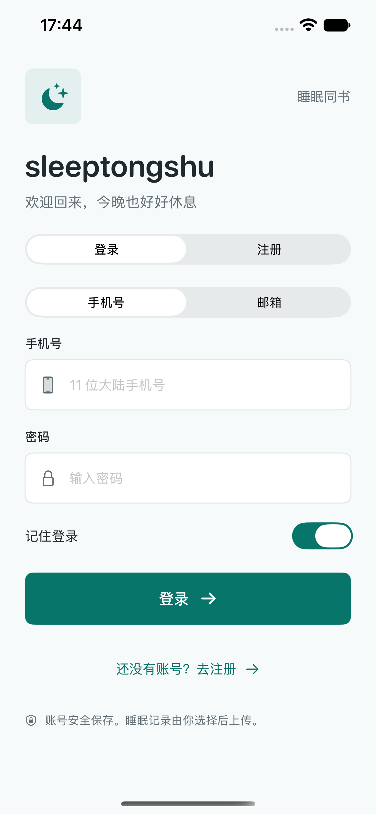
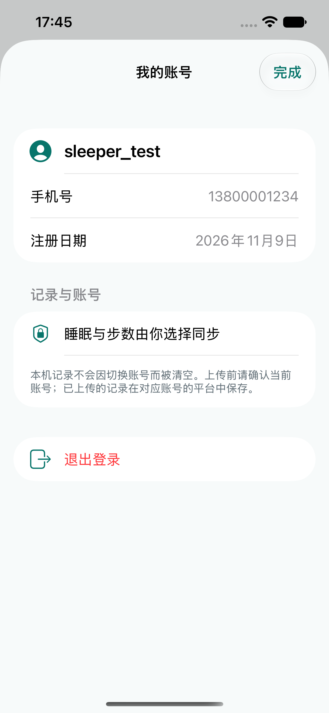
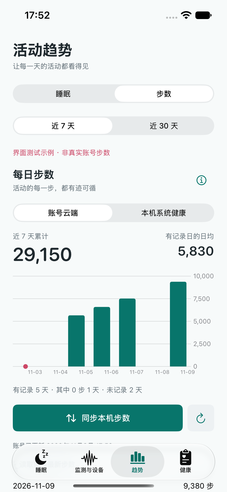
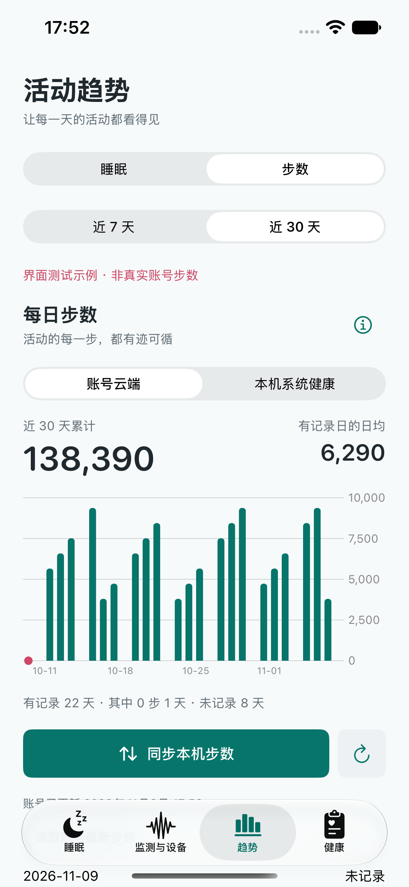
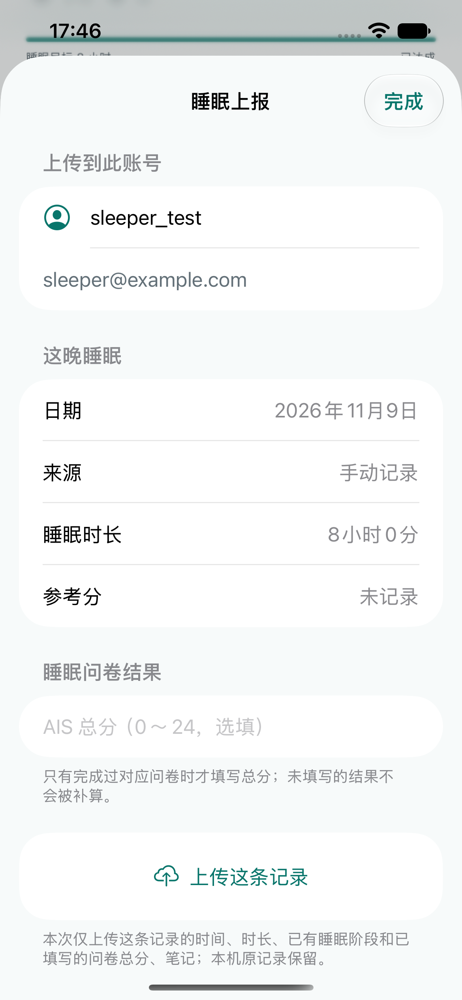

# 手机号账号与云端步数：0.3.6（20）

2026-11-09。在原有 SwiftUI、SwiftData、HealthKit、APIClient 工程增量实现；不另建客户端。后端仓库 `Rocgrey/sleep_tongshu_web` 已核对 main 提交 `fa6deda0ced88a73534d5a72dd9449d43f171a17` 的 schemas、auth、health 和部署 OpenAPI。本次无需修改后端，App 源码仅提交 `Rocgrey/tongshusleep`。

## 账号契约

| 接口 | 实际请求及处理 |
| --- | --- |
| POST `/api/v1/auth/register` | `username`, `password`, 可选 `phone`、`email`，至少一种联系方式。App 默认手机号，邮箱选填；空字段直接省略。返回 201 `{message}`，成功后回登录，不能把注册视为已登录。 |
| POST `/api/v1/auth/login` | 手机号模式只发 `phone`,`password`；旧邮箱模式只发 `email`,`password`。返回 `access_token`,`token_type`,`expire_at`（Unix 秒），再调用 `/me`。 |
| GET `/api/v1/auth/me` | Bearer；用户模型 `id`,`username`,`phone?`,`email?`,`created_at`。邮箱可为 null 或缺失；数据身份只取服务端整数 `id`。 |
| POST `/api/v1/auth/logout` | Bearer；先清本机状态，再请求服务端撤销。离线时说明本机已退出，不谎称服务器已撤销。 |

当前后端支持大陆 11 位手机号密码登录，无短信服务。本版不制作验证码、不验证手机号所有权、不拼接虚假邮箱，不合并相同联系方式的不同账号。手机号接受空格、连字符和 +86 前缀，发送规范化号码。注册用户名 3～32 位中文/字母/数字/下划线，密码 6～72 字符且最多 72 UTF-8 字节；确认密码不发送。已有邮箱账号仍可登录。

Keychain 继续保存服务地址、用户和 JWT，不保存密码；关闭记住登录时只留内存会话。旧版没有 phone 的 Keychain 可正常解码。恢复时必须校验到期时间、服务地址和 `/me` 返回的稳定用户 ID。401 统一退出；旧会话返回的 401 不退出新会话。重复点击受 loading 状态拦截；400/409/422、网络异常、超时沿用统一提示。

## 步数契约

POST `/api/v1/health/step-record`：

```json
{
  "record_date": "2026-11-09",
  "steps": 1234,
  "source": "healthkit",
  "source_id": "system-health-statistics",
  "data_time": "2026-11-09 18:00:00",
  "timezone": "Asia/Shanghai"
}
```

示例仅说明格式，App 上传值来自实际 HealthKit 日汇总。`steps` 为 0～200000 整数，`data_time` 为读取快照时间。归属由 Bearer token 决定，请求不含 `user_id`。响应使用 `record_id`,`applied`,`reason`,`record`；校验 `record.user_id`、日期与来源。

唯一键 `(user_id, record_date, source)`，同一天同来源用新的**累计值替换**，不是增加步数。旧 `data_time` 不覆盖新值；失败重试仍使用原快照的日期和时间，无自动 POST 重试。上传后一定 GET 读取账号实际返回结果；部分上传失败时不在界面假装云端成功，提示可重试。

GET `/api/v1/health/step-records?start_date=2026-11-03&end_date=2026-11-09`：起止日均包含。解析 `days` 和 `summary`：

- 每日：`record_date`,`steps`,`source`,`source_id`,`data_time`,`updated_at`,`sources_available`,`is_today`,`is_real_zero`。
- 汇总：`start_date`,`end_date`,`days_in_range`,`days_with_record`,`days_real_zero`,`days_missing`,`range_incomplete`,`total_steps`,`avg_steps`（可为 null）。
- 日期选择沿用趋势页近 7/30 天；增加睡眠/步数切换，保留原睡眠筛选、图表和记录。
- 云端与本机有明确来源切换，每行显示日期、来源、采集/读取和服务更新时间；失败保留已读云端并标为缓存，不把本机值当作云端值。

### 去重与日期

本机仅上传系统健康 `HKStatisticsCollectionQuery(.cumulativeSum)` 的每日汇总，不逐来源相加。服务端同一天选择 `healthkit > wearable > phone > 其他`，同优先级选更新记录；不把手机、手表、系统汇总和云端再次累加。本版仅上传 `healthkit`，但兼容读取账号其他来源的步数。

当天累计可多次更新，每次替换同一天的值。真实 0 步有记录并参与日均；没有记录不传、不补 0、不参与日均。日均 = 累计 / 有记录天数。空柱位为缺失，底部圆点为真实 0 步。

**当前后端按 UTC+8 判断日期，GET 不支持 timezone 参数。** App 步数查询和图表统一用 `Asia/Shanghai`，上传标明同一时区。不猜测额外参数。旧 HealthKit 快照没有分日时区标签：保留原健康展示，但需重新读取后才能上传，防止跨时区错日。异常、截断、重复或非整数日汇总不上传。部分健康项目刷新成功但步数读取失败时，保留步数原来的读取时间与时区，不把旧值标成新采集；回到前台时重新检查账号周期。

云端缓存按服务地址 + 稳定 user ID 做 SHA-256 文件名隔离，位于 Application Support/AccountSteps，使用 iOS 文件保护原子写入，不存 token。退出/切换立即清空云端页面状态；操作捕获 session，代次检查阻止旧请求返回更新 UI 或写入新账号缓存。重新登录只加载同一服务同一 ID 的缓存并明确标为未刷新。原有本机睡眠/健康/蓝牙记录不清除，上传前由用户确认当前账号。

## 移除 ISI

App 移除输入、展示、评分及上传 DTO 的 ISI 字段；新 JSON 完全省略 `isi_score`，不发送 null 或 0。AIS 仍为选填 0～24，保留其他睡眠指标。历史响应含多余 `isi_score` 由 Decodable 忽略。SwiftData 原有 SleepRecord 从未增加该字段，不改 schema、不删库、不重建本地记录；旧上传回执继续使用。历史版本文档只作归档，不再作为当前契约。

## 配置与自测

服务地址统一在 `Configuration/Service.xcconfig` 的 `SLEEP_API_BASE_URL`（必须 HTTPS，包含 `/api/v1` 前缀）；备用常量 `APIConfiguration.defaultBaseURL`。测试私有覆盖使用忽略的 `Configuration/ServiceLocal.xcconfig`，参考 `ServiceLocal.example.xcconfig`。WorkBuddy 网关访问码仅本机保存，不能作为用户 JWT；不提交分享码、cookie、密码或凭证。无网关的正式服务清空 `SLEEP_GATEWAY_SHARE_CODE`。

1. 不填邮箱，用手机号注册；登录、查看个人页，结束进程重开，确认 `/me` 恢复；退出后回登录页。测试重复手机号、错误密码、无效手机号和断网。旧邮箱账号从“邮箱”入口登录。
2. 健康页允许读取步数并更新；趋势→步数→本机系统健康，核对真实日期和值；切换账号云端，点同步，核对接口返回、总数、日均和更新时间。没有权限/没有记录时不伪造数据。
3. 重复同步同一快照，累计不得翻倍；当天增加步数后重新读取再同步，更新当天累计。跨日、0 步、空白日、不同来源优先级、离线缓存均应对应规则。
4. 同步中切换账号/退出，旧请求不得恢复旧账号页面；新账号无旧账号云端步数。401 清除会话，重新登录后由用户决定是否重试。
5. 保存非示例睡眠记录，仅选填 AIS 后上传；JSON 无 `isi_score`。含历史额外字段的响应应能读取，原本地睡眠、蓝牙和健康记录保留。

自动化：`xcodebuild test -project sleeptongshu.xcodeproj -scheme sleeptongshu -destination 'platform=iOS Simulator,name=iPhone 17e' -only-testing:sleeptongshuTests -only-testing:sleeptongshuUITests/AccountUITests`。

真实 Swift 联调需在模拟器为 App 开启 `RunLiveBackendChecks` 后运行 `LiveBackendTests`；默认跳过，防止普通单测向线上写入。标准库脚本 `scripts/test-live-auth.py --write-test-account` 使用 `SLEEP_API_BASE_URL` 和可选 `SLEEP_GATEWAY_SHARE_CODE`。测试只写合成账号与合成记录，不读取真实用户记录。后端没有账号/步数删除接口，测试账号与标注的测试步数保留，测试睡眠记录会删除。

## 文件清单

新增：`AccountStepsModels.swift`（日期、DTO、API、缺失语义），`AccountStepsStore.swift`（账号隔离、同步、缓存），`AccountStepsView.swift`（图表、来源、统计和说明），`AccountStepsTests.swift`（同步与隔离回归），本说明。

修改：`AccountAPI.swift`、`AccountStore.swift`、`AccountView.swift`（手机号、可选联系方式、旧账号兼容）；`APIClient.swift`（统一 query 编码）；`HealthOverviewModels.swift`、`HealthOverviewStore.swift`（步数分日时区）；`SleepTongshuApp.swift`、`SleepDashboardView.swift`（状态注入与趋势切换）；`SleepUpload.swift`、`SleepUploadView.swift`（仅 AIS）；账号、上传、真实服务和 UI 测试；独立联调脚本；README、旧文档提示及版本配置。完整代码在仓库对应文件内。

## 后端配合与边界

现有手机号/步数接口满足本版需求，无需新增字段和路径。以后若支持全球当地日界，需要服务端明确 GET 时区参数、返回每条记录时区、跨时区合并规则；本版统一 UTC+8。手机号所有权验证需真实短信服务，不能靠 App 模拟。测试数据清理需后台管理或未来授权删除接口，客户端不猜测路径。实体手机的 HealthKit 权限及真实步数值仍需在手机验证，模拟器与合成接口测试不替代真机数据核对。

## 验证结果与界面

2026-11-09：98 项 Swift 测试通过（包含明确开启的真实服务联调），7 项界面测试通过。最后的步数日期轴调整还单独复跑步数图表及原睡眠趋势详情测试，均通过；图表测试实际检查截取画面中的柱形颜色像素，防止只有坐标轴却无柱形。账号、步数和上传单测涵盖手机号无邮箱、旧邮箱、请求字段、Keychain 恢复、401、断网/超时、切换账号的旧请求、缓存隔离、缺失/0 步、跨日和重复同步，以及新 JSON 不含 ISI、历史字段忽略。步数保留原读取时间的回归测试也通过。

真实部署的 Python 联调额外验证：手机号注册与重复、错误密码、旧邮箱账号、云端当天累计替换、旧时间不覆盖、来源优先级、真实 0 步与空白日、有效日均、第二账号无第一账号记录、退出后 401；Swift 使用实际 App DTO 和 APIClient 验证手机号注册→登录→`/me` 恢复→步数上传回读→AIS 睡眠上传→删除测试睡眠→退出→旧 JWT 拒绝。未上传任何本机真实健康数据；合成测试账号/步数仍在测试账号下，管理端可按 `swiftcheck_`、`ios_check_` 前缀辨认。

模拟器构建及戒指工程 iPhone 签名构建通过。当前实体 iPhone 状态为 unavailable，因此本次未安装至手机，也未在真实 HealthKit 中核对用户本人步数；这部分仍需连接手机授权后验证。蓝牙硬件同步没有在本轮重新做实体设备测试。

以下界面使用自动化测试账号与明确标注的合成图表，仅用于展示布局，不代表真实用户云端数据。图表夹具只在 DEBUG 的显式 UI 测试参数下启用，不写缓存、不上传，正式构建不包含该实现。

<p>
  
  
  
  
  
</p>
