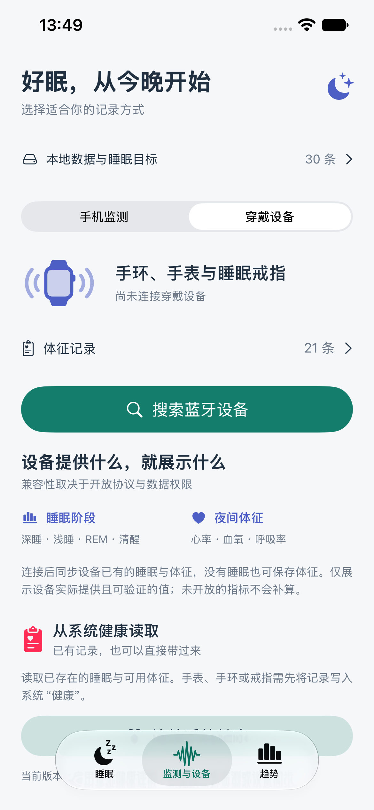
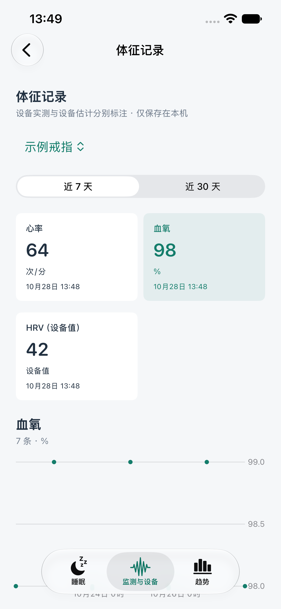

# 设备同步 0.2.2

日期：2026-10-28。真机工程：`sleeptongshu-Ring.xcodeproj`，scheme：`sleeptongshu-Ring`。普通工程不链接设备 SDK，适用于模拟器、Mac Catalyst 和数据/UI 测试。

## 日常使用

1. 进入“监测与设备 → 穿戴设备”。本版第一次连接需搜索一次；成功后在本机保存设备 UUID、通用名称、上次连接时间，不保存周围所有扫描结果。
2. 下次点“已连接过的设备”直接重连，使用 `retrievePeripherals(withIdentifiers:)`，不先执行 App 扫描。若系统已清除此标识，需要重新搜索；设备须在附近、蓝牙开启且允许连接。
3. 匹配且启用数据通道的戒指在服务识别后自动同步。“戒指睡眠同步 · 测试”已移除，改为正常的“睡眠与体征同步”；诊断收纳到“同步详情”。同步包含设备验证及时间校准，结束后释放连接，可随时取消。
4. 没有睡眠也可保存设备已有的有效体征；点“体征记录”查看可用指标、最新值、7/30 天图表和最近 20 条详细值。设备分开显示，不混算多设备均值。无记录的指标不生成卡片、不显示假数值。
5. 体征独立保存在受文件保护的 `Documents/wearable-vitals-v1.json`，重复历史同步更新同一条，不重复累加。实时标准蓝牙体征每种指标最多每分钟保存一条，时间标注为接收时间。
6. “本地数据与睡眠目标”可单独导出体征 JSON、清空本机体征。睡眠 JSON 格式继续兼容旧版；体征 JSON 不使用睡眠导入入口。清理不清除设备及 SDK 缓存，再同步时可能重新导入；忘记设备仅移除快捷连接，不清除健康数据或设备绑定。

## 支持范围

| 数据 | 读取路径 | 当前限制 |
| --- | --- | --- |
| 电量、型号、实时心率 | 标准 180F/2A19、180A/2A24、180D/2A37 | 必须设备开放并实际发送；服务存在不等于有测量 |
| 血氧 | 标准 1822/2A5E、2A5F，或戒指 SDK 血氧历史 | 解析 SFLOAT，排除异常状态、缺包、0/255；不对未知私有包猜数值 |
| 血压 | 标准 1810/2A35，或 SDK 原始 systolic/diastolic | 标准 kPa 转 mmHg；验证有效范围及收缩压大于舒张压，未知或异常格式不保存 |
| 戒指心率 | SDK heartValue；缺失时取 ecgs/ppgs 有效心率数组的时段均值 | 数组不是原始光学波形推算；不编造数组中每个点的精确时间 |
| 戒指 HRV | 设备声明支持后串行读取 HRV 历史，hrvValue 字段 | 算法/单位未经该设备核实，显示“设备值”，不标作 SDNN/RMSSD 毫秒 |
| 压力 | SDK 原始 stress 字段 | 保留设备定义，不推算心理状态；0 暂作缺失，避免混入未佩戴占位值 |
| 血糖 | SDK 自动测量历史 bloodGlucoses | 仅设备支持且已有值时显示；数组按有效值时段均值展示，单位未核实前显示设备原值，不自动换算 |
| 血液成分 | SDK 自动测量历史，胆固醇、甘油三酯、HDL、LDL、尿酸 | 使用 SDK 已定义字段，数组为时段均值；全部标注设备估计，不当作化验结果 |
| 呼吸率 | SDK 已定义 RespirationRate | 0、255 及越界排除 |
| 睡眠 | 普通或精准睡眠表，睡眠类型含 6 | 分期验证、时间连续、跨段校验通过才保存；真实过夜曲线仍待核对 |

本次没有启动设备端的新测量，不改动血压、血糖校准，也没有对未定义字段、手动测量原始结构猜测缩放或时间戳。SDK 支持的自动历史字段不代表此戒指硬件一定具备全部传感器。健康指标供个人观察，尤其无创血糖、血脂和尿酸估计不能代替专业测量、化验或调整用药依据。

连接和验证最长等待 40 秒，基础历史传输最长等待 180 秒；血氧、HRV 各自最多等待 30 秒。可选通道超时只保留已返回的数据；缺失指标不补算。设备声明无此通道则跳过。诊断中的“体征窗口数量”是原始容器数，不是有效测量数量；解析完成后单独报告有效条数。

## 手环免登录的边界

用户这只手环已经开放电量和心率标准服务，但截图没有标准血氧/血压服务；不能把普通连接状态当作其他历史数据已解密。当前没有其专用历史协议适配，也未完成 HRV 私有字段验证。

核对的 Gadgetbridge 资料把 Mi Band 10 Pro 列为实验支持，并明确要求 Xiaomi token：先由配套 App 绑定，再获取认证密钥。它是 Android 项目，不能直接安装到本 iOS App，也不是无认证读取的证明。

- [设备列表及 10 Pro 说明](https://gadgetbridge.org/gadgets/wearables/xiaomi/#device__xiaomi_mi_band_10_pro)
- [认证密钥获取说明](https://gadgetbridge.org/basics/pairing/huami-xiaomi-server/)
- [数据协议功能及限制](https://gadgetbridge.org/basics/topics/xiaomi-protobuf/)

可研究的后续路径是使用用户自己设备已有的有效绑定密钥做本地认证，并完成该型号加密协议适配；仍需实测固件和 NFC 版本。获取密钥往往仍需一次正常绑定/登录，不能承诺从未登录的全新设备完全跳过首次认证。本 App 不要求创建账号；本版未加入令牌获取工具，也不收集账号密码。

## 验证

  
  

29 项单元测试已通过，包括新增的体征与睡眠独立、占位值过滤、冲突测量处理、血压关系、SFLOAT/截断/异常状态、本地持久化与去重、设备记忆及通用名称测试；真实 iPhone 签名构建通过。界面自动化及此次最终安装结果记录在 `VALIDATION_V2.md`。

此前这枚新戒指已实测连接、验证通过，睡眠表为空，所读体征字段为占位值。目前不能将协议代码、构建成功或模拟测试写作真实 HRV、血氧、血糖等全部测量已经传输成功。各指标须实际佩戴并生成测量后逐项核对。用户原始日志、设备数据库、健康值不纳入 Git。
