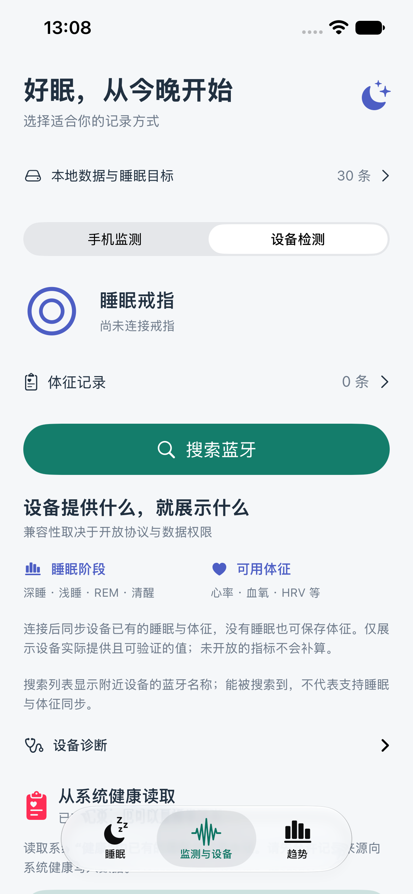
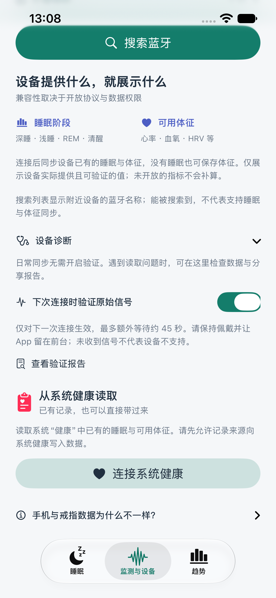

# 0.2.6（10）：日常同步与数据过滤

## 日常使用

1. 打开“监测与设备 → 设备检测”。
2. 点击已连接过的设备直接重连；首次使用点“搜索蓝牙”并选择设备。
3. 识别受支持的数据通道后自动同步睡眠、体征和电量，无需点同步按钮。保持 App 打开，等待“本机已保存”。
4. 在“睡眠”查看设备返回的睡眠阶段，在“体征记录”查看已有数据及图表。没有记录的项目不会补造。
5. 同步结束释放连接，电量标为最近读取的值。再次读取时点击已保存的设备重连。

## 诊断入口

“设备诊断”位于设备检测页面下方，默认折叠。同步详情、标准数据检查和验证报告集中放在这里，已有报告仍可查看和导出。

“下次连接时验证原始信号”默认关闭，只保存在当前页面状态，不沿用旧版持久开关。一次同步开始时消耗此选项，重启也恢复关闭。普通历史同步无需额外等待逐次心跳接口。

需要检查接口时，断开设备后开启该选项，再重新连接。最多额外等待约 45 秒；未收到信号、等待超时和未请求分别保留原有说明，不将超时解释为硬件不支持。没有新增未知蓝牙命令。

## 有效值与本地保存

- 新读取的体征沿用原有数值验证和冲突检查。
- 从旧体征文件加载后，图表、列表计数及体征 JSON 导出同样只采用可见且通过数值验证的记录，排除零值、255、超出对应数值边界及明显未来的时间。
- 加载与过滤不重写旧文件，也不删除原始记录；此改动不迁移睡眠记录、不清空示例或真实数据。
- 范围检查只排除无法使用的值，不代表通过检查的数值具有医疗准确性。血压仍为设备估计，HRV 和压力仍显示“设备值”。

## 验证报告改进

已有真实报告显示，SDK 的许多字段是数字文本，因此旧版只显示样例、没有记录上下限。新版统计这些数字文本的范围；时间文本不参与数值统计。范围仍包含零值和占位值，用于诊断，不自动转成健康记录。

补充活动汇总、步数、睡眠阶段点数、接口编号及未知分析字段的说明。活动汇总不等于连续身体活动信号；`Temp1` 换算未确认，不能当作体温；分析字段为零也不能据此判断健康状况。

此次用户报告中历史同步已完成，但抽查的光学和心电历史数组为空，逐次心跳接口超时，没有主动波形回调，身体活动原始接口未请求。目前继续使用设备已经计算的睡眠分期，未增加自己的深睡、浅睡、快速眼动算法。历史字段可能包含 SDK 此前缓存，报告也有抽样上限；这不是完整蓝牙抓包。

用户的健康 JSON 不加入仓库、不自动上传。

## 验证记录

- 45 项单元测试通过，包含旧体征文件不被重写、无效值不进入展示和导出、数字文本统计与占位值保留。
- 4 项相关界面测试通过，覆盖日常入口、旧验证设置不沿用、重启恢复关闭、无信号报告、候选图表和已有体征图表。
- 已检查模拟器截图，无文字重叠。下图使用隔离的界面测试数据，不是用户的健康记录。
- 真机包构建与签名校验通过，0.2.6（10）已覆盖安装并启动在连接的 iPhone。
- 安装前后体征文件和已有验证报告逐字节一致，睡眠记录表内容摘要一致，原有睡眠记录全部保留。本次没有代替用户进行新的戒指测量或实际同步。
- 日志、原始报告及手机备份只保留于忽略提交的 `work/device-merge/`。本次没有对原始信号支持能力作出新的判断。

  
  

