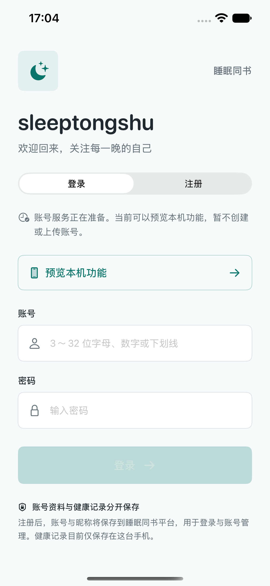
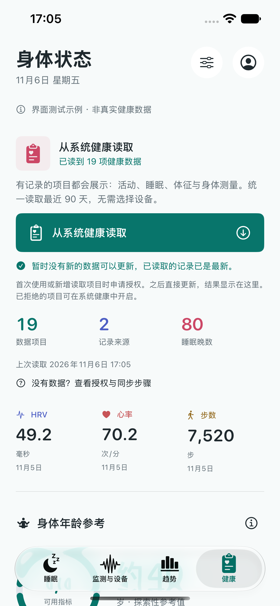

# 健康读取与账号入口：0.3.4（18）

日期：2026-11-06。

健康页将“允许更多读取项目”合并进“从系统健康读取”主按钮。按钮使用 54 点高度、8 点圆角、单色填充及图标；页面标题右侧改为账号入口。新权限申请由同一个按钮触发，已有记录仍在页面展示。

只有 HealthKit 返回 `shouldRequest`，且当前读取项目集合尚未完成请求时，才打开系统授权。`unnecessary` 与 `unknown` 都不强行弹窗。完成过当前集合的请求后不会反复申请，之前拒绝的项目在系统健康中手动开启。新增读取类型时开发者需要递增 `authorizationSchema`。自动刷新与下拉刷新只读取已有权限。

新增、无变化和失败结果都在按钮下方显示，无成功弹窗。重复刷新不因为检查时间推进而声称有新数据。健康设置也使用相同读取入口，没有订阅全局成功消息的弹窗。

手机最近保存的快照已包含心率、步数、步行跑步距离、活动能量、静息能量与睡眠。系统来源标识经过通用名称处理，这份快照不能单独证明某条记录来自指定品牌；新的配套 App 数据需在手机同步和授权后再刷新验证。快照和真实健康数据仅用于本机检查，不提交仓库。

账号功能按 [平台接口约定](ACCOUNT_API_V034.md) 准备。目标 Web 仓库当前为空，用户确认尚未部署，因此当前版本提供明确的本机预览入口；不把本地预览称为注册成功。正式服务地址配置后，进入 App 前需要登录；现有会话保存在钥匙串，密码不落盘。账号与健康数据上传分开，本轮不会上传健康记录。

## 验证与手机测试

2026-11-06：82 项单元测试及 4 项界面测试通过。界面覆盖未部署时的预览、模拟服务注册进入及退出、错误密码原页提示、无新健康数据时不弹窗。自动化输入关闭模拟器的密码生成建议，正式运行仍保留系统密码自动填充。测试不创建真实平台账号，不替代部署后的接口联调。

戒指真机工程签名构建通过，0.3.4（18）已覆盖安装并打开在已连接的 iPhone，未卸载或清除本机记录。当前先选择“预览本机功能”，在健康页点“从系统健康读取”，首次新增权限由用户允许；若配套 App 已向系统健康写入记录且获准访问，刷新后会显示。受权限保护的实时读取结果仍需在手机确认。

## 界面截图

以下是模拟器截图。健康数值为界面测试示例，不是真实健康记录。

  
  

