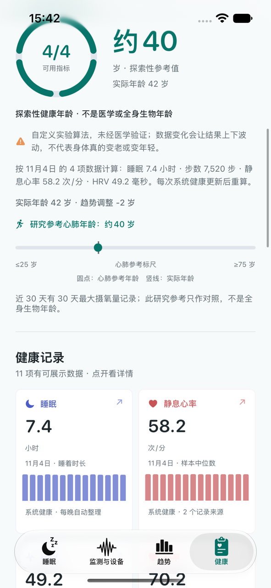

# 健康刷新与探索性年龄：0.3.1（15）

日期：2026-11-05。

## 最新验证 JSON

`AIZOSDKLog 4/device-validation.json` 的 SHA-256 与前一份 `AIZOSDKLog 3/device-validation.json` 完全一致。这仍是固件 `00.12.11` 的戒指报告：2 晚睡眠、170 条体征、0 个波形样本、0 个原始块。心跳间隔请求超时且支持情况未确定。它不是新的 BIO 整夜记录。

## 刷新时保留健康页

HealthKit 文档说明，每次调用 `requestAuthorization` 都会再次提示用户，不论过去是否已授权。本版先调用 `statusForAuthorizationRequest`；已无需请求时跳过弹出的授权流程。只有确实需要请求时才显示系统授权界面。

读取仍在当前健康页完成。页面显示当前读取项目、进度条和百分比，旧快照在新数据全部写入之前一直保留。错误改在原页面内说明，不用错误弹窗把用户带离。睡眠导入错误也不阻止其他健康数据更新。

## 探索性健康年龄

用户同意增加明确标注的实验性估算。它绝不称作医学年龄或全身生物年龄，也不是已验证的预测模型。

算法规则完全公开在 App 的说明页：

1. 使用最近 7 个完整自然日内，至少有两类有效指标的最新同一天。今天不纳入。
2. 睡眠分数以 7.5 小时为中心，每偏离一小时扣 18 分；步数以 8,000 步映射；静息心率以 50 次/分为起点，每高 1 次扣 1.2 分；HRV 对比此前 30 天个人日中位数，每高/低 1% 加/减 1 分。
3. 每项限制在 20～80 分，等权平均。相对 50 分每偏离 10 分，估算年龄相对实际年龄调整 1 岁，调整限制为上下 3 岁。
4. 实际年龄可从系统健康读取，也可在健康设置手动输入。未取得实际年龄、或同一天不足两项指标时显示“数据不足”。普通心率不替代静息心率；没有个人基线的 HRV 不计入。

这些阈值和映射只是满足探索性展示的自定义规则，未经过科学验证。结果随数据波动，不应据此诊断、治疗或比较不同的人。设备、佩戴状态、记录完整度和数据来源变化都会改变结果。原有 FRIEND 最大摄氧量表仍单独展示，不能与本探索性值混为一谈。

刷新健康数据后按最新完整日期重算。没有新记录时，数字不会因为日历经过一天而伪装成更新。

下图为 UI 自动化测试中的示例界面，包含模拟记录和模拟年龄，仅用于检查布局与说明文案，不是用户的真实健康测量结果。

## 验证

- 单元测试覆盖同日数据门槛、排除今天、缺少实际年龄及调整上下界。
- UI 测试确保刷新进度出现时，原有健康卡片与导航仍然可见。
- 真机安装新版前不清理 App 数据，也不覆盖既有健康快照。
