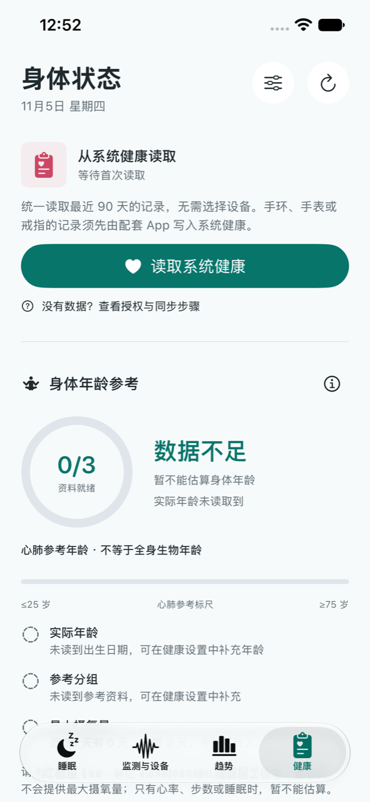
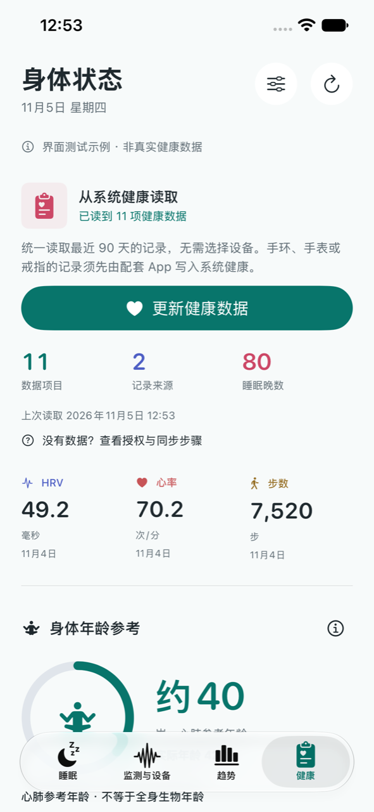
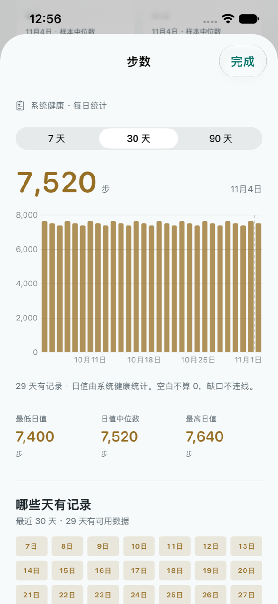
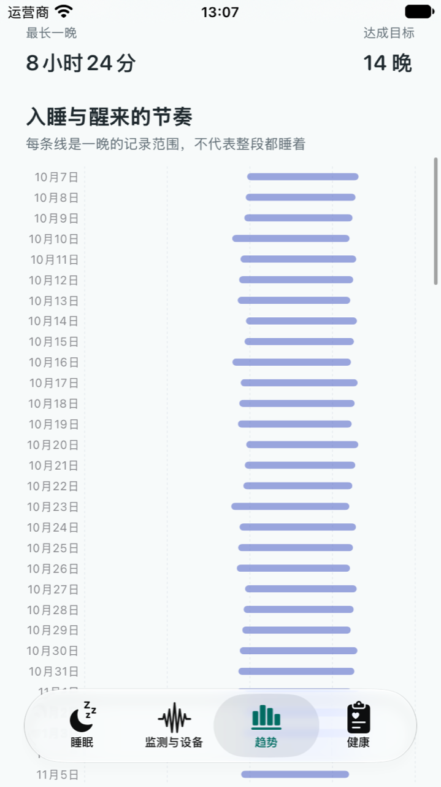

# 健康页与整夜验证：0.3.0（14）

日期：2026-11-05。

## 健康数据为何看不到

实机本地快照已存在心率、步数和睡眠记录。旧版先展示身体年龄、长期变化和恢复条件，实际健康项目在较下方，容易被理解为读取失败。

本版把读取状态、最近的实际数值和数据日期提前展示。其余项目仍然只在有可用数据时展示，点开可看趋势、最低/最高日值、日值中位数、记录覆盖图和解释。灰色日期是没有读到记录，不是当天数值为零，也不是身体异常。

读取范围为最近 90 天；首次需要用户点击读取并授权。已有快照后，回到健康页或 App 回到前台时，超过 15 分钟会检查更新；自动尝试之间至少间隔 60 秒。也可以点击更新或下拉刷新。UI 测试不会自动访问真实健康数据。

某晚睡眠整理失败时，不再阻止已读到的体征与活动生成快照；失败项目会显示提示。清空快照仍只清理本 App 的概览，不删除系统健康记录。

## 不需要选择品牌或设备

读取不限制品牌，也不要求每个项目选择设备。条件是配套 App 已将相应项目写入 iPhone 系统健康，且用户允许 sleeptongshu 读取。

用户可以在健康 App 的个人资料中找到“App 与服务”或“App”，选择 sleeptongshu 开启项目；配套 App 也需要开启向系统健康共享。健康 App 的“显示所有数据”“数据来源与访问权限”可以用于确认实际记录。App 内提供可打开健康 App 的指引入口，打开失败时提示从桌面进入，不依赖不存在的逐项权限直达链接。

HealthKit 不向读取方披露某项是否被用户拒绝。因此页面使用“未读到”，不擅自宣称未授权。授权、未同步、设备未提供及没有近期记录都可能导致空结果。

## 身体年龄为什么显示数据不足

本版保留现有透明的心肺参考年龄算法，没有添加未经验证的全身年龄或衰老速度公式。其条件为：

1. 实际年龄 20～79 岁；系统未提供时，可手动补充。
2. 研究使用的参考分组；未提供时，可手动补充。
3. 最近 30 个完整自然日至少 3 个不同日期的最大摄氧量记录，今天不计入。

不满足时显示“数据不足”，逐项显示缺少内容和日期数，提供权限及参考资料入口。资料准备环的 0/3～3/3 只表示条件数，不是健康得分。研究来源、中英文题名和作者仍可查看。

有心率、步数、睡眠不代表一定有最大摄氧量；一些设备不会写入这项记录。读取授权不会生成设备本来没有提供的数据。

## BIO 新报告核对

用户指定的 `device-validation.json` 是固件 00.12.11 的戒指报告。随后只读检查已连接手机的本 App 数据容器，找到了 11 月 5 日新保存的 BIO9 / 103.0.0.11 报告，证实用户已重新读取。

新报告心跳间隔目录有 72 条，上次为 38 条；但旧版请求上限只有 8 包，实际保存 7 包，不能据此检查整夜。新报告这 7 包不同于上次 7 包，初步拆包得到 299 个正数候选间隔及 26 个非正标记，包时间戳跨度 3042 秒。设备时间含义仍待核对，不把时间戳直接认定为准确的本地测量时间。

因此本轮只调整已使用的历史读取接口范围，没有猜测或开启新的传感器命令：

- 健康历史仍最多请求 120 包。
- 心跳间隔最多请求最近一个有效目录块中的 288 包，等待上限从 12 秒扩大到 30 秒。
- 其他通道仍各最多 8 包；总存储上限为 512 包、2 MB。
- 新报告保存每类请求的起止序号，展示实际收到的包数；旧报告缺少这些字段仍可打开。
- 设备页展示读取时间，接入报告增加通道包数图，避免将旧文件误认为本次读取。

这仍是有边界的接入验证，不保证目录包含整夜或所有目录块，也未更改尚未确认的序号边界语义。扩大请求范围后，需要实际重新连接设备，并核对新的读取时间、请求序号、返回包数和时间覆盖。没有把候选间隔计算为 HRV 或睡眠阶段。

## 页面图形

- 健康：读取概况、实际值摘要、身体年龄资料准备环、图表卡片、日值汇总、日期覆盖图。
- 睡眠：新增阶段环图；未分期和未记录仍保留独立分类，不能混入深睡或清醒。
- 趋势：新增每晚记录开始至结束的时间图；图中范围不代表全程睡着。
- 监测与设备：统一配色及图标，手机运行圆环依据真实已用时相对 23 小时上限绘制；设备接入增加读取时间和通道图。

所有真实记录保留原来源。测试示例有明确标签，不向真实健康快照混入示例数据。原始日志、设备地址、账户和手机数据容器备份不提交 GitHub。

## 验证与预览

- 67 项单元测试通过，覆盖健康汇总、年龄条件、旧报告兼容、协议请求和原有数据逻辑。
- 12 项不同的 UI 用例最终通过，包含权限指引、空状态、有数据状态、参考资料、统一来源、睡眠、趋势、监测、蓝牙入口和体征图表；部分用例在两种尺寸重复验证。
- iPhone 17e 和 iPhone SE 第三代模拟器检查布局及截图，月度作息图另行检查日期与记录的对齐。
- 真机签名包含 HealthKit 权限，安装 0.3.0（14），确认系统健康快照实际刷新并继续包含心率、步数和睡眠。原有本机数据保留。
- 扩大的心跳间隔读取范围已完成编译与协议边界检查，尚需重新连接真实 BIO 后验证整夜覆盖，不能把旧版 7 包的结果当成本版已经完成整夜读取。

下图为无数据状态或自动测试的示例，均不含用户真实健康记录。

| 数据不足说明 | 有数据的健康首页 |
| --- | --- |
|  |  |

| 记录覆盖图示例 | 月度作息图示例 |
| --- | --- |
|  |  |
