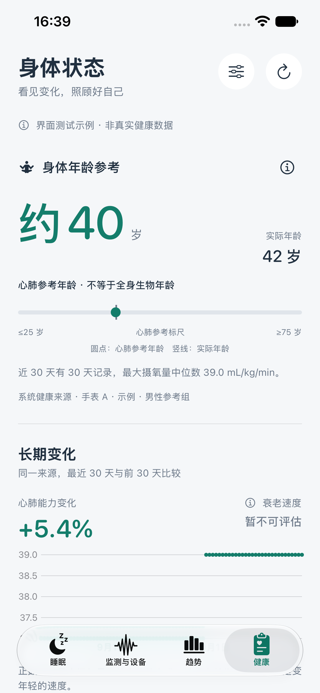
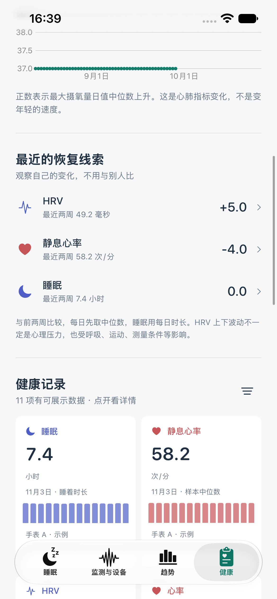
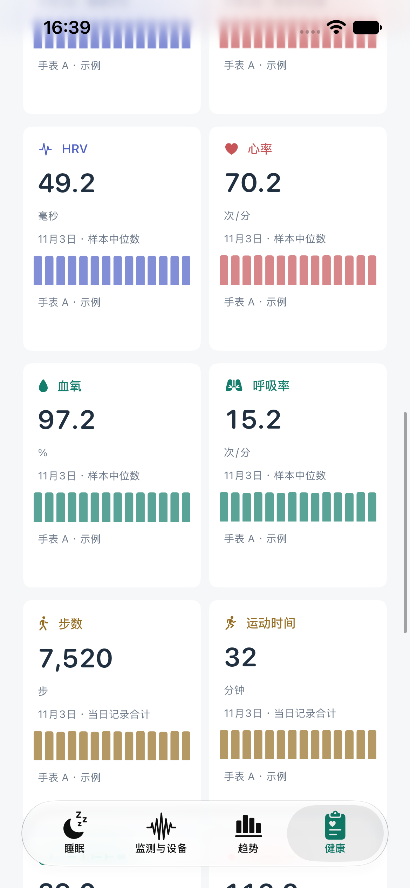
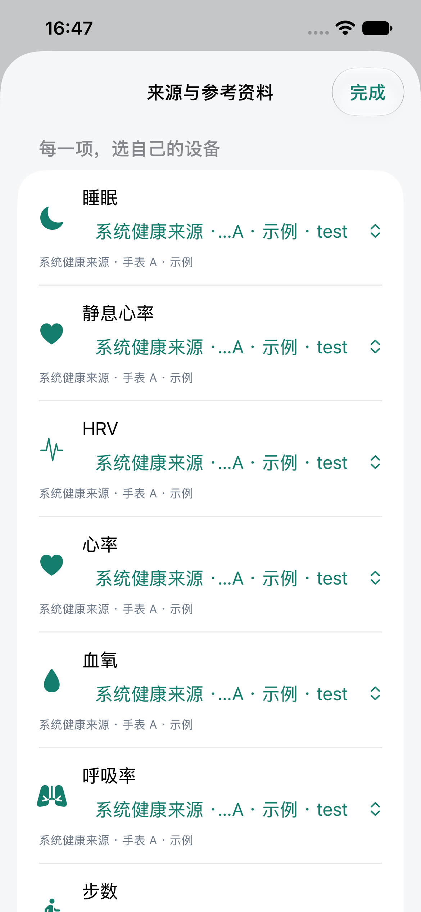

# 系统健康与身体状态 0.2.8（12）

## 这版做什么

新增底部“健康”页面，从系统健康只读最近 90 天的睡眠、心率、静息心率、HRV（SDNN）、血氧、呼吸率、步数、运动时间、血压高压/低压和最大摄氧量。年龄和参考分组是可选读取项，也可手动填写。所有计算在本机进行，没有账号、服务器同步或厂商云算法调用。

“监测与设备 → 从系统健康读取”仍用于导入睡眠报告，新增“健康概览与身体年龄参考”入口。健康概览的来源设置不擅自改变睡眠报告导入来源。

## 如何测试

1. 打开“健康”页，点“读取系统健康”。在系统授权页选择允许的项目；并不要求全部允许。
2. 点右上角滑杆图标，逐项查看“来源与设备”，例如让睡眠来自戒指、步数来自手表。来源会显示设备描述及简短区分标识。
3. 首次默认选择该项目记录数最多的来源，随后保留用户选择。上次选中的来源本次没有记录时，显示无记录，不自动换成另一台设备。
4. 点任意健康项目，查看 7/30/90 天图、数值解释及最近日值；详情页也能切换来源。切换设备只展示新选择的记录，不把两台设备相加。
5. 若有最大摄氧量记录，读取或填写实际年龄与参考分组，查看心肺参考年龄及算法说明。资料不足则显示空白及缺少的条件。
6. 新数据写入系统健康后，点右上刷新图标重新读取；本版没有后台持续订阅。快照的读取日期、项目的实际记录日期均会显示。

系统健康不会向 App 透露某一项“拒绝读取”的状态；空结果可能是没有数据或没有权限。授权请求成功不表示所有记录都已获准读取。选择某台硬件的前提是来源在记录中写入了可区分的设备信息；没有标明设备时，不可能凭空恢复该身份。

## 设备区分和睡眠导入修正

- 用来源应用标识加设备 localIdentifier 区分设备；缺失独立标识时，使用名字、厂商、型号、硬件版本组合，并明确提示同名同型号可能无法区分。内部组合编码后散列，不在界面展示长应用标识或蓝牙地址。
- 睡眠导入仍保持旧的单一来源导入 ID，避免普通来源重复导入；若旧来源键实际对应多个可分辨硬件，分开展示并附加区分键。遇到这种较少见的历史歧义，旧记录仍保留，用户可检查后手动删除不需要的旧汇总记录。
- 睡眠体征只匹配同一来源与设备身份，并且完全落在睡着区间内。不再因为睡眠记录没有设备 localIdentifier 就放入同应用其他设备的心率。

## 日值和缺失处理

- 心率、静息心率、HRV、血氧、呼吸率、血压、最大摄氧量：先按单一所选来源分天，显示有效样本中位数，降低采样频率差异的影响。它们不等于连续监测的全天平均。
- 睡眠：按当地中午分组过夜记录，合并重复区间，清醒和仅卧床不算睡眠；阶段冲突或记录缺口不补成睡眠。按起床所在日期展示睡着小时数。
- 步数和运动分钟：只合计一个来源的样本，UUID 去重。某天有重叠的累计样本或跨日且无法准确拆分的区间，该天不合计，不能凭时间比例编造每日步数；空白不等于 0。
- 每类最多读 50,000 条、优先最近记录；达到上限时明确标记，该项目暂不生成日值，避免把截断数据当作完整记录。
- 参考年龄、变化比较均排除尚未结束的今天。每日面板可以显示今天的已有记录，注明当日记录合计，不声称覆盖全天。
- 各项有效值有基础格式/范围过滤；过滤不是健康诊断。图表使用柱或散点，不跨缺口画连续曲线。

## 身体年龄与衰老速度的边界

**当前实现的是“心肺参考年龄”，不是全身生物年龄。没有把 HRV、睡眠、血氧和心率任意加权后编造年龄，也没有声称复现 StressWatch 的私有算法。**

采用 FRIEND 2015 研究表 3 的实测跑台最大摄氧量第 50 百分位：

| 年龄段 | 中点 | 男性参考 | 女性参考 |
| --- | --- | --- | --- |
| 20～29 | 24.5 | 48.0 | 37.6 |
| 30～39 | 34.5 | 42.4 | 30.2 |
| 40～49 | 44.5 | 37.8 | 26.7 |
| 50～59 | 54.5 | 32.6 | 23.4 |
| 60～69 | 64.5 | 28.2 | 20.0 |
| 70～79 | 74.5 | 24.4 | 18.3 |

单位为 mL/kg/min。这里使用 FRIEND 的实测参考行，不使用同表的 Cooper Clinic 预测行。

算法版本 `FRIEND-median-v1`：

1. 所选单一来源最近 30 个完整自然日，至少 3 天有有效最大摄氧量；先取每日中位数，再取所有日值中位数。
2. 年龄须为 20～79 岁，需明确选择研究的男性或女性参考组，否则不给结果。
3. 与对应参考列比较，在相邻年龄段中点之间按直线换算年龄，显示到约 5 岁。高于或低于表格端点分别显示 ≤25、≥75，不外推。
4. 这一步年龄转换是 App 的探索性展示，不是该论文验证过的年龄预测模型。人群为美国无心血管疾病成人，设备估计值也不同于实验室实测；不能当成通用的身体年龄检测。

“长期变化”为同一来源最近 30 天相对前 30 天的最大摄氧量日值中位数变化百分比，两段各至少 3 天。公式为 `(近期中位数 / 前期中位数 - 1) × 100%`，不年化，不把变动解释为老化或逆龄。**“衰老速度”当前明确显示暂不可评估**；未来若接入适用且经验证的模型，应另行说明需要的数据、验证人群和误差。

HRV、静息心率、睡眠的恢复线索：比较相邻且不重叠的两个 14 日窗口，各至少 7 天；取各窗口日值中位数之差。不生成心理压力诊断，也不参与年龄计算。

## 参考资料

页面仅展示中文译名、文章英文原名和作者，无网页链接。

- 中文译名：《通过运动测试建立的心肺能力参考标准》。原文：Reference Standards for Cardiorespiratory Fitness Measured With Cardiopulmonary Exercise Testing: Data From the Fitness Registry and the Importance of Exercise National Database。Leonard A. Kaminsky、Ross Arena、Jonathan Myers，2015，表 3。DOI：10.1016/j.mayocp.2015.07.026。
- 原文核对位置：[PMC 全文](https://pmc.ncbi.nlm.nih.gov/articles/PMC4919021/)，[Europe PMC 书目信息](https://europepmc.org/article/MED/26455884)。这些研发链接只放在文档中。
- 成人睡眠建议参考：Recommended Amount of Sleep for a Healthy Adult: A Joint Consensus Recommendation of the American Academy of Sleep Medicine and Sleep Research Society。Nathaniel F. Watson 等，2015。
- 活动建议参考：WHO Guidelines on Physical Activity and Sedentary Behaviour。World Health Organization，2020。

## 本地存储

健康概览单独存入 Documents/system-health-overview-v1.json，保留最近一次刷新快照、逐项来源选择以及可用的年龄/参考分组，不保存完整生日。使用原子写入与设备数据保护；刷新失败保留旧快照，损坏文件保留并提示。

在“来源与参考资料”中可导出该快照或确认清空。清空只影响本 App 的健康概览，不删除系统健康、睡眠库或蓝牙体征；手动参考资料使用单独的本机设置。用户未操作时不会上传健康快照；真实记录、SDK PDF、日志及设备地址不会提交到 GitHub。

## HR802

本次两份文档中发现 iOS 的候选 PPI 接口，但没有实际 SDK 二进制、头文件及 Demo，未宣称已读通 HR802。详见 [HR802 SDK 文档核对](AIZO_HR802_SDK_REVIEW.md)。

## 本次验证

2026-11-04：

- 63 项单元测试通过，覆盖设备身份隔离、来源选择保留、日值去重/缺失、跨日累计排除、睡眠区间合并、心肺参考表及适用条件。
- 4 项界面测试通过，覆盖空白状态、研究原名说明、两台设备的数据切换及原有统一扫描入口。随后扩展并单独复测来源选择测试，通过；截图取自 iPhone 17e 模拟器，并已检查布局。
- 带 HealthKit 权限的戒指版本真机签名编译通过，0.2.8（12）已覆盖安装并打开在连接的 iPhone 上。没有卸载 App，也没有清理用户记录。
- 安装前后已备份 Documents 与 Application Support；Documents 文件逐项比对一致，SwiftData 睡眠记录导出摘要一致。备份、测试日志、设备标识和真实健康记录只留在忽略的 work 目录中。
- 尚未替用户操作系统健康授权弹窗；新健康页实际能读取哪些项目，取决于用户授权与系统中已有的数据。没有把界面测试记录当作真机健康记录，也没有完成 HR802 SDK 实机读取。

## 界面预览

以下均为明确标记的界面测试示例，非用户真实健康数据。仅在调试构建同时带有 `-ui-testing` 与 `-ui-testing-health` 参数时加载，不会用于本次真机更新。

| 健康概览 | 长期变化与恢复 |
| --- | --- |
|  |  |
| 健康项目图表 | 逐项选择来源 |
|  |  |
