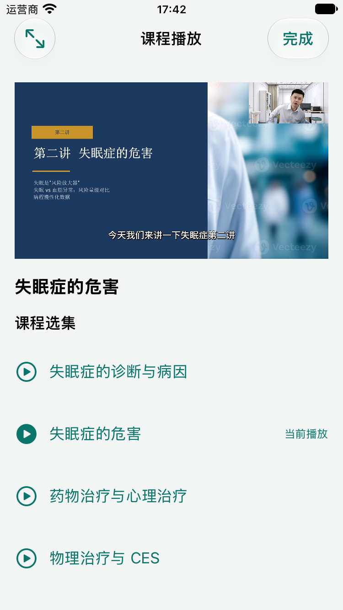
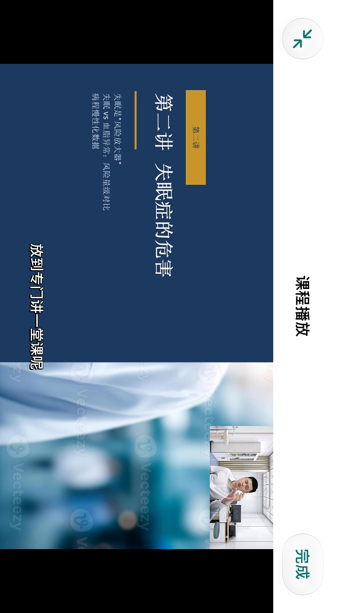
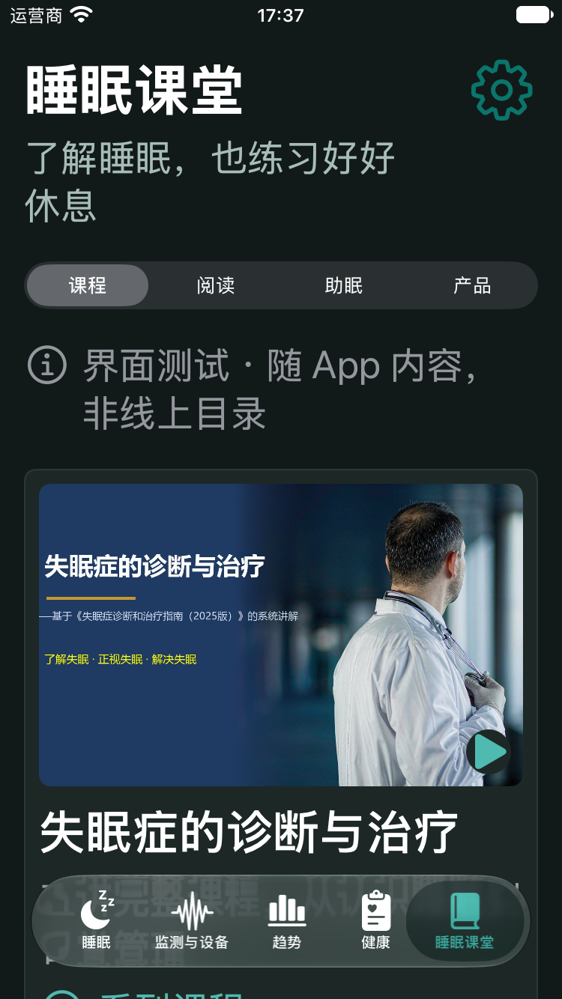

# 0.4.2（23）：课程直接播放与动态内容

继续使用同一个 sleeptongshu、Bundle ID、Keychain、SwiftData 和原 WorkBuddy 服务。基线为 `5620524` / `v0.4.1`，旧版和标签保留；不删除或迁移健康数据库。本版不改变睡眠采集、BIO、HealthKit 和上传接口。

## 使用方法

1. 打开“睡眠课堂 → 课程”，点课程封面直接进入播放，自动选择排序最前的有效章节；单视频课程直接播放自身地址。没有可播放媒体时仍显示真实内容详情和空状态。
2. 竖屏下可以在“课程选集”切换章节，每节独立保存本机进度；切换会停止前一节，过期请求不能覆盖当前视频。
3. 顶部左侧展开图标为“横屏播放”，再点可退出横屏；点“完成”关闭后恢复竖屏。使用 iOS 场景方向 API，不旋转视频画面来伪装横屏，不重建播放器或丢失进度。
4. 没有旧网页平台的试看限制；实际播放范围由提供的视频文件和合法媒体访问权限决定。正在手机监测录音时不抢占音频会话。

## 新增视频与商品

App 目录来自现有 Web 的 `/api/v1/content/items`，播放前读取详情地址。手动下拉立即刷新；再次进入、返回前台时遵守现有 15 分钟检查间隔，不每次切换页面请求。支持分页、缓存、网络失败、更新和下架。

| 操作 | App 如何更新 |
| --- | --- |
| 只向视频 CDN 上传文件 | 不会自动出现，还缺课程名称、封面、分组和发布状态 |
| 后台添加课程及章节，填写真实媒体地址并发布父项和章节 | 下拉刷新后出现，点击即播放，不需更新安装包 |
| 后台添加商品，填写名称、图片和核实后的京东外链并发布 | “产品”刷新后出现；图片和按钮可跳转购买 |
| 只填写京东链接 | 当前不会自动抓取标题和图片，还需填写内容字段 |
| 后台更新或下架内容 | 刷新后更新或移除；播放前详情 404 不恢复下架内容 |

视频必须使用 `https://vid.sleep.phoenixtreeai.com` 下实际存在且有权播放的文件地址，CNAME 仅供 DNS 解析。App 不枚举云存储桶，不包含腾讯云密钥，不依赖旧网页课堂。新素材图片用可访问 HTTPS URL；内置素材名仅适用于安装包中已有图片。

给 WorkBuddy 的完整提示词已提交到 Web 仓库：
[WORKBUDDY_CLASSROOM_V042.md](https://github.com/Rocgrey/sleep_tongshu_web/blob/main/docs/WORKBUDDY_CLASSROOM_V042.md)。本轮不要求新增 API 或数据库迁移；生产部署和内容发布由 WorkBuddy 审查后执行。

## 修改文件

- `ClassroomContent.swift`：章节确定性排序、可播放章节解析，复用原内容服务。
- `SleepClassroomView.swift`：封面直接播放、全屏播放器、选集、请求取消保护、横屏及前台刷新。
- `SleepReminders.swift`：App 方向代理，播放器外保持竖屏。
- 普通工程与 `Configuration/VeepooRing.xcconfig`：允许播放器申请横屏，版本 0.4.2 / 23。
- `EnhancedContentTests.swift`：动态新课程、商品、地址替换、下架及无章节课程测试。
- `SleepClassroomUITests.swift`：一键播放、选集、横屏、竖屏恢复，以及小屏/深色/大字体回归。
- README、本说明及界面测试截图。

## 验证

- iOS 模拟器：217 项单元测试，无失败、1 项条件跳过；3 项课堂 UI 测试通过，包含课程入口、选集、真实横屏尺寸断言及恢复竖屏、深色大字体和三套主题。
- 内容单元测试使用明确的 `example.test` / synthetic 测试目录，不能代替生产目录验收。界面截图采用“界面测试”模式的随 App 课程，不包含私人健康数据；视频画面来自现有真实媒体。
- 普通工程模拟器构建、保留设备 SDK 的手机工程签名构建通过；0.4.2（23）已覆盖安装并成功启动。安装前后本地数据库对比，原有睡眠记录主键全部保留；未卸载 App，HealthKit 签名权限保留。手机上的横屏操作及真实账号新内容仍需用户最终确认，模拟器验证不能代替真机体验。
- Web 现有内容与通知接口 15 项回归测试通过。本轮为部署/发布说明更新，继续沿用现有内容与商品接口。生产管理员新发布、私有媒体鉴权、京东系统跳转需由 WorkBuddy 与用户最终验收，不宣称已发布新视频。

界面测试截图（随 App 真实课程、非私人健康记录）：

## 构建与运行

普通模拟器：Xcode 打开 `sleeptongshu.xcodeproj`，选择 `sleeptongshu`。真机保留设备 SDK：打开 `sleeptongshu-Ring.xcodeproj`，选择 `sleeptongshu-Ring`，使用原 Team 和 Bundle ID 构建。环境配置继续使用被 Git 忽略的 `Configuration/ServiceLocal.xcconfig`，不要将访问码或其他凭据提交 Git。
