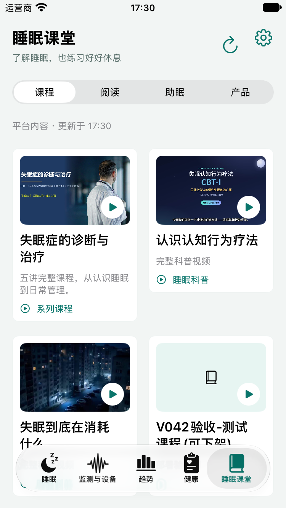
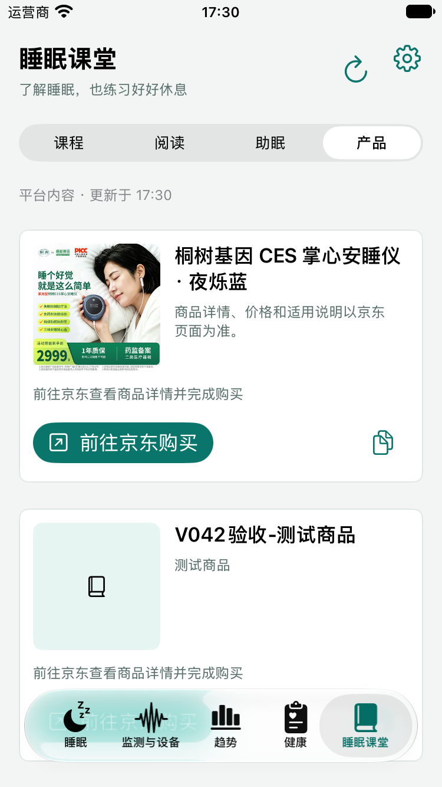
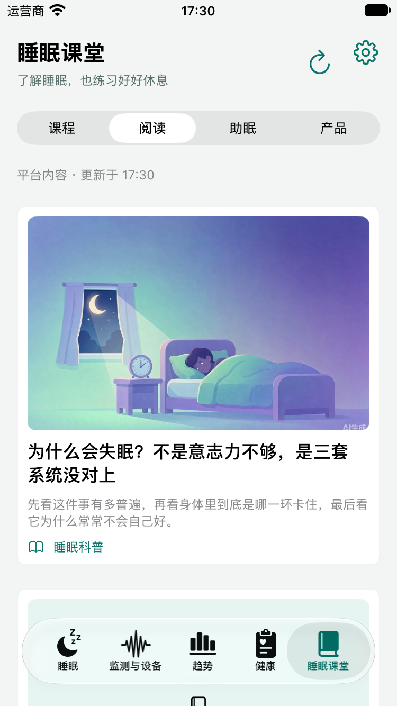

# 0.4.3（24）：线上课堂与睡眠同步修复

基线 `15df67a` / `v0.4.2`，保持同一个 App、签名团队、Bundle ID 和本地数据库。开发前已保留原有未提交的工程设置及历史截图，不纳入本次提交。Web 使用 WorkBuddy 已部署的原服务，核对的最新基线为 `dbf40cf`。

## 原因与修复

### 上架内容没有显示

实际线上公共目录已返回 21 项已发布内容，包括新增测试课程、两个章节、测试商品和测试文章。手机此前只有 16 项旧缓存，接口字段与客户端模型一致。

旧课堂使用 15 分钟缓存检查，依靠页面 `.task` 和前台事件触发；Tab 保留页面时再次进入不一定重新执行任务，前台停留也没有周期检查。新版把课堂是否选中作为任务标识：进入或回到前台时检查，保持前台且选中时每 60 秒检查，离开课堂或后台时取消。手动刷新按钮和下拉刷新立即请求，显示“平台内容 · 更新于…”。后台未发布、定时未到、已下架内容仍不展示，不用本地目录冒充线上新内容。

CDN 上传仍需后台添加课程信息并发布；本次不增加云存储扫描、不猜测视频路径、不修改媒体访问权限。测试商品没有封面时显示缺图状态，不伪造商品图。

### 11 月 17、18 日睡眠不在平台

手机真实数据库中各有两份记录：系统健康与设备来源。本机已存在成功上传回执，但当前服务端没有对应记录；旧同步只判断本机回执，因此不会再次补传。当前证据可以确认“本机回执与服务器不一致”，不能据此断定具体是哪次部署或操作造成缺失。

新版启动或登录恢复后先用现有 `GET /api/v1/health/device-records`，按本机记录日期范围分页读取当前账号清单。使用服务地址和稳定 user ID 隔离，核对 `record_key`、`revision_at` 及睡眠结果关联；缺失或旧版本记录重新进入队列。使用同一个 `POST /api/v1/health/device-sync`，保留已保存版本号，超时重试不生成重复记录。健康来源与设备来源仍独立保存，按睡眠结束日归属，不将两份睡眠相加。

成功对账后 15 分钟内不反复拉清单；新本机记录仍可按原同步循环上传。请求 401 使用统一登录失效处理；退出、换账号或旧请求取消后不覆盖新账号。单条 400/409/422 不阻塞其他夜晚，失败记录保留并显示未完成状态。清单解码由现有后台 actor 执行，避免大批体征 JSON 阻塞主线程。

本机 `AutomaticSync/status/latest.json` 只保存账号 ID、核对/同步时间及待处理日期供排查，不含凭据、手机号或健康数值，不上传该诊断文件。真实记录、回执和调试文件只在被忽略的本地目录，不提交 Git。

### 移除趋势页账号云端

删除步数来源中的“账号云端”页面及其读取、手动同步按钮，只展示“蓝牙设备 / 系统健康”。保留实际 0 步、缺失日、7/30 天累计和有效日均规则。原后台自动上传、账号认证、睡眠监测、设备同步和 HealthKit 导入继续使用。

## 实测结果（2026 年 11 月 22 日）

- 已登录用户主动测试的同一台 iPhone 覆盖安装 0.4.3（24），未卸载 App。
- 手机实际目录更新为 21 项，新增测试课程、章节、商品、文章的 ID 全部出现在手机缓存；模拟器启用真实内容接口的只读界面测试也显示这些内容。测试没有创建或修改线上内容。
- 手机同步核对完成，待处理日期为空。通过管理员只读接口回读，17、18 日各有一份系统健康和一份设备睡眠，共四份真实记录；仅核对日期、来源和标识，不把私人健康数值输出或保存到仓库。
- 普通模拟器与设备 SDK 工程构建通过。222 项单元测试无失败（1 项条件跳过），包括私有目标记录回放（可用时）、缺失回执补传、同版本重试、分页、跨账号响应拒绝、401、服务地址隔离和单条失败不阻塞其他记录。
- 共 8 项相关 UI 测试通过：课堂、横屏、选集、深色大字体、主题、设备睡眠、7/30 天步数、手机号登录及“账号云端”入口移除。线上内容测试需开发者明确准备只读检查文件；没有该文件时跳过，不影响离线测试。
- 再次启动手机后重复读取服务端，四份目标睡眠的 ID 保持一致，没有重复创建；原有本地睡眠记录主键全部保留，同步诊断无待处理日期。
- Web 全套 139 项测试通过，包含新增“跨日多来源睡眠清单、缺失后原版本补传、重复上传不重复建行”的回归用例。

## 手机操作

1. 打开新版并登录日常账号，“睡眠课堂”右上角刷新；课程、阅读、产品分别查看对应已上架测试内容。
2. 保持前台且“自动同步健康记录”开启，睡眠页显示核对及同步状态。后台仍以当前登录账号为归属；在 Web 选择同一用户及 11 月 17～18 日查看，不选管理员自身账号代替日常账号。
3. 趋势 → 步数只有设备及系统健康两种来源。此处不显示云端页面不影响平台收到数据。

## 文件与构建

主要修改：`ClassroomContent.swift`、`SleepClassroomView.swift`、`SleepTongshuApp.swift`、`AutomaticSync.swift`、`SyncPreparation.swift`、`AccountStepsView.swift`、`DeviceStepsView.swift`；版本配置、测试夹具入口和相关单元/UI 测试一并更新。

普通工程用 `sleeptongshu.xcodeproj` / `sleeptongshu`；保留设备 SDK 的真机工程用 `sleeptongshu-Ring.xcodeproj` / `sleeptongshu-Ring`。继续使用被忽略的本地服务配置，凭据不写入文档或 Git。

后台本次不需要新接口、生产迁移或重新部署。Web 仓库提供回归测试和交接说明；建议 WorkBuddy 检查数据库持久化、备份与恢复策略，以免仅依赖在线手机补回服务器缺失记录。未在开发机操作生产部署或重置数据库。

## 线上内容界面截图

以下为模拟器从真实部署读取的已发布测试内容，不含私人健康数据。新增测试项的空封面为服务端实际配置。

