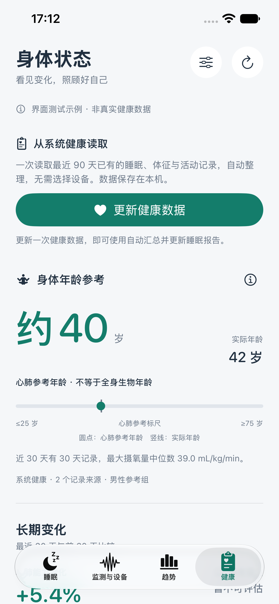
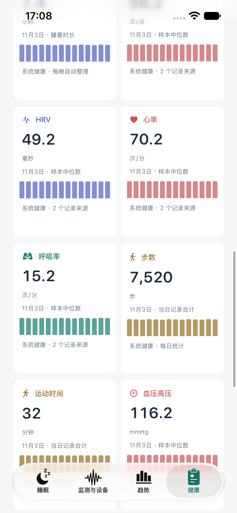
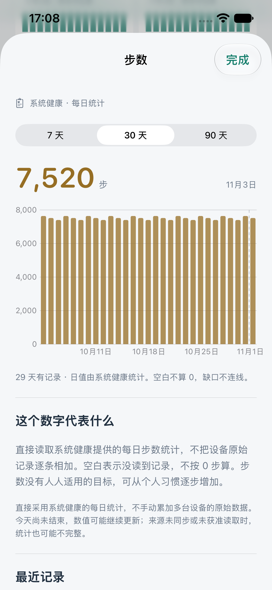
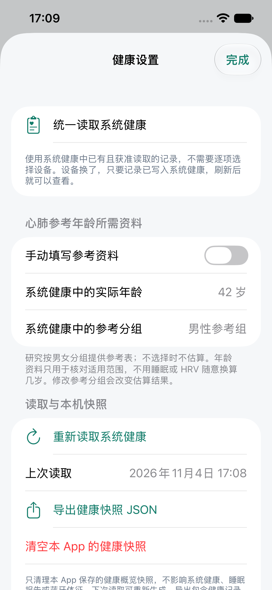

# 统一健康读取 0.2.9（13）

## 操作方式

1. 打开底部“健康”，点“读取系统健康”；已有快照时按钮为“更新健康数据”。
2. 在系统弹窗中允许需要的项目。App 自动汇总最近 90 天的已有记录，不再要求为每个项目或睡眠导入选择设备。
3. 有有效日值的项目才显示图表卡片。点开查看 7/30/90 天图表及解释；没有记录不补 0，也不补造身体年龄。
4. 同一次刷新会把整理好的睡眠报告保存到本机睡眠库，可直接去“睡眠”和“趋势”查看。不再另点导入按钮。
5. 右上角设置用于年龄参考资料、快照备份和清理。记录来源只供查看，不是设备选择器。

“监测与设备”中的整个系统健康模块及跳转入口已移除；该页继续负责手机采集和蓝牙设备。系统健康页面不改变蓝牙连接、绑定或厂商协议。

## 自动汇总规则

- 当前支持的项目为睡眠、心率、静息心率、HRV（SDNN）、血氧、呼吸率、步数、运动分钟、最大摄氧量、血压高压和低压。只查询这 11 项及可选年龄/参考分组，不声称读取了系统健康全部类型。
- 步数与运动分钟使用 `HKStatisticsCollectionQuery` 的每日 `cumulativeSum`，读取系统返回的日统计；不在 App 里把手表和手机的原始步数逐条相加。系统健康 App 的显示设置/来源优先级并未作为可读取配置开放，本版不承诺所有项目与其界面数值完全一致。
- 心率等非累计项目汇总全部已读取来源的有效样本，先按 UUID 去重，再将同起止时间且同值的重复记录只计一次，生成每日中位数。高压、低压独立展示，不拼成一次血压测量。
- 睡眠以当地中午为边界分夜。每晚优先采用深睡、浅睡、快速眼动信息覆盖更长的一份来源；再比较睡着时长，最后用稳定的来源标识排序打破平局。这个选择是本 App 的汇总规则，不冒充系统健康的私有来源排序。
- 同一晚不把两台设备的睡眠相加或拼接分期。选中来源内部的重复区间合并，缺口/互相矛盾的阶段保留未记录；仅卧床和只有清醒的记录不生成睡眠。
- 睡眠报告中的心率、血氧和呼吸率只匹配该晚同来源/设备、且落在睡着区间的样本。健康概览仍显示其他来源的可用体征；它们不会被擅自标为这份睡眠的体征。
- 非累计类型每项最多读取 50,000 条；达到上限时明确提示并暂停该项汇总，避免截断记录被当作完整数据。步数和运动日统计不受该样本上限影响。单项读取出错时继续显示其他已成功读取的项目；全部查询失败则保留旧快照。

图表是本 App 的日值整理。系统健康中的设备/测量方式改变，也可能造成趋势变化；不把设备切换解释为身体突然变好或变差。HRV 仍只使用系统健康中同一种 SDNN 量纲。

## 旧数据与重复导入

0.2.8 的本机快照可直接打开，旧的逐项来源选择被忽略；刷新后保存统一汇总。旧快照中的原始步数不是新的系统日统计，若含多来源则暂不相加，刷新后重新读取。

新的睡眠导入键以“系统健康 + 夜晚”生成，与当前设备无关。重复刷新更新同一份报告；匹配旧版同晚系统健康报告时保留其本机 ID 并更新内容，不新建一份。手动、手机监测和蓝牙报告均保留；旧库中若早已存在同晚多个来源的历史报告，不擅自批量删除。

健康快照仍保存在 `Documents/system-health-overview-v1.json`，新增可选睡眠报告和读取提示字段。读取成功后先保存快照，再更新睡眠库；若睡眠库保存失败会明确提示，可重新刷新。不会只因打开页面就发起读取、上传或改写旧记录。

系统授权成功不等于所有项目获准读取。空结果既可能是没有记录，也可能是未允许访问；App 无法据此判断某一项权限被拒绝。每次刷新仍须由用户主动发起。

## 身体年龄参考

继续沿用 [0.2.8 的 FRIEND 实测参考表与适用条件](HEALTH_OVERVIEW_V028.md)，转换公式未变；输入改为系统健康全部可用最大摄氧量样本的日中位数，算法标识更新为 `FRIEND-median-v2`。参考表及研究原名、作者仍可在 App 说明中查看。设备变化可能影响比较，仍不输出全身生物年龄或衰老速度。

## 验证

- 65 项单元测试通过，包括多来源体征去重、旧快照选择迁移、每晚睡眠自动选取、同设备睡眠体征匹配，以及重复刷新更新旧 ID、保留手动报告。
- 5 项界面测试通过，包括取消选择器、仅显示已有项目、健康空状态、参考文献原名和设备页只有一个扫描入口。
- 两个工程已完成编译验证；0.2.9（13）已覆盖安装并打开在连接的 iPhone 上，已生成实际系统健康快照及睡眠报告。
- 安装前后已备份本机文件；除刷新生成的健康快照外，Documents 文件一致，非系统健康的睡眠记录内容摘要一致。原有手机监测、手动和蓝牙报告均保留；新增及更新的系统健康报告属于本次读取结果。真实数据与备份只保存在忽略的 work 目录，不上传 GitHub。
- 本次手机上部分血压项目读取未完成，页面保留逐项提示，其余项目继续显示；不宣称每一类数据都已读全。实际覆盖仍受系统记录和授权范围影响。

以下截图使用明确标注的界面测试示例，不是用户的真实健康数据：

| 统一读取 | 已有数据的图表 |
| --- | --- |
|  |  |
| 项目详情 | 健康设置 |
|  |  |
