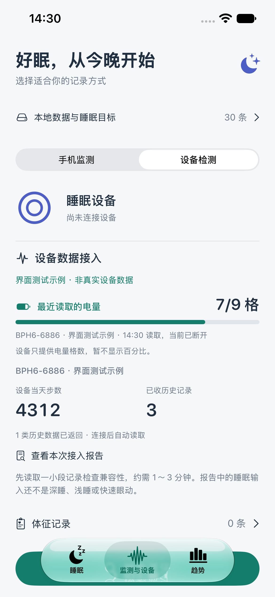
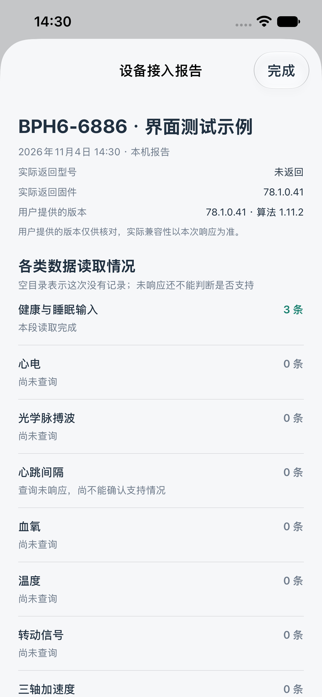
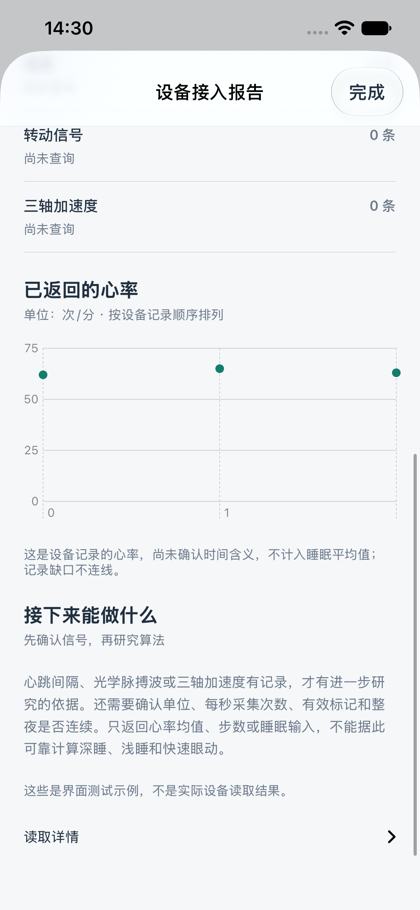

# 手表与手环接入测试 0.2.7（11）

日期：2026-11-04。此版本把公开协议接入到 App，供实际设备验证。代码测试、真机构建不等于三款硬件已经兼容；硬件结果以连接后导出的报告为准。

## 本轮设备

| 用户提供的蓝牙名称 | 用户提供的版本 | 状态 |
| --- | --- | --- |
| BPH6-6886 | 固件 78.1.0.41，算法 1.11.2 | 待实际连接、读取验证 |
| H02C-4190 | 99.0.100.4 | 同时保留较早提供的 H102C 名称识别，扫描时显示实际名称 |
| BIO-7349 | 103.0.0.11 | 待实际连接、读取验证 |

版本信息只作核对，不能证明设备具有某种传感器或数据接口。配套应用为用户提供的 V9健康，产品提示仍使用通用设备称呼。

## 怎样测试

1. 先结束其他配套 App 的同步，保持设备在手机旁边并正常佩戴。有记录可先在配套 App 中确认，但不必解绑或恢复出厂设置。
2. 打开 sleeptongshu → 监测与设备 → 设备检测 → 搜索蓝牙，选择其中一台设备的实际名称。
3. 连接后自动检查接口并读取，无需再点击同步。保持 App 在前台，通常等待约 1～3 分钟。可随时断开结束，已收记录会保留。
4. 点“查看本次接入报告”，等待本次验证结束，再点“分享接入报告 JSON”。每台设备分别导出一份，文件名包含本次开始时间及匿名设备标识。
5. 断开后再连接下一台。已连接过的设备会保留快捷记录；后续点击直接重连。“设备诊断 → 最近的手表与手环接入报告”可重新打开最近一份；之前的报告文件仍在本机 Documents/wearable-validation。

如果只显示连接成功、没有兼容接口，已知设备名称仍会生成包含服务清单的报告。如果设备没有可识别名称，请分享“设备诊断”的文字服务清单。

## 实际读取范围

- 先按实际服务及特征 UUID 匹配协议，不仅靠名称猜测协议，也不向其他蓝牙设备发送私有查询。
- 读取设备型号、固件版本、电量及当天累计步数。协议电量为 0～9 档，按档位画电量条；若标准电量服务提供百分比，仍可按百分比显示。
- 分别查询健康与睡眠输入、心电、光学脉搏波、心跳间隔、血氧、温度、转动信号、三轴加速度的历史目录。
- 只取每类目录最后一个有效区间中的最近一段：健康最多 120 条，其他每类最多 8 条；一轮最多保存 200 条、JSON 与二进制内容合计约 2 MB。不是全量历史备份，也不保证覆盖整夜或取得所有设备数据。
- 每次目录等待最多 4 秒，每段历史接收最多 12 秒，写请求确认/发送繁忙最多 3 秒。分段接收结束后发送文档中的停止同步请求。取消或断连时保存部分报告。
- 捕获的历史记录含按厂商定义解析的 JSON，以及保留未知字段的 Protobuf 二进制 Base64。仅支持通过 CRC 校验、长度不超过 32 KB 的协议帧。
- 未发起定位、通讯录、加密历史、主动传感器测量、出厂测试、校准、绑定变更、设备时间/其他设置或云端算法请求。加密或授权需求须取得对应型号的正式说明后适配。

## 怎样理解结果

- **设备返回空目录**：本次该类型没有历史记录；不能推断硬件没有这种能力。
- **查询未响应**：可能是协议版本、权限、连接占用或接口不支持，不能仅据此下结论。
- **设备拒绝请求/返回状态码**：保存拒绝结果，不虚构数据，后续按报告核对。
- **收到记录**：表示收到了可解析的记录包，不自动等于获得完整、可用的原始波形。还要检查实际字段、数组长度、标记和连续性。

健康记录中的有效心率可在报告中按记录序号画散点图。历史设备时间与单位仍需结合实测确认，因此不会冒充手机当前时间写入体征记录，也不参与睡眠平均值和睡眠评分。设备主动返回的有效实时心率/血氧可沿用标准本地体征存储，注明蓝牙接收时间。

睡眠输入数组不是深睡/浅睡/快速眼动结果，不生成睡眠图。原始脉搏波、心跳间隔及三轴信号即使收到，也要核对单位、采样率、有效标记、时间对齐和整夜覆盖，再决定自研算法。既有戒指同步、系统健康读取及已存睡眠/体征不受此测试路径替代。

## 本地数据与报告

报告仅写手机 Documents/wearable-validation，设备标识使用散列，不保存设备信息响应中的蓝牙地址、账户或连接密码。历史健康字段可能包含敏感数据，导出由用户主动分享；不会自动上传服务器或提交到 GitHub。产品已隐藏的估计指标不会因此重新出现在体征页。

## 实现与来源

- [厂家公开 iOS 示例](https://github.com/iwown/BLE_SDK_2020)：协议 UUID、8 字节帧头、CRC16/XMODEM、设备信息、实时订阅和历史索引/读取命令。BSD 3-Clause 声明保存在 App 随附 IWOWN-NOTICE.txt。
- [厂家协议定义包](https://api8.iwown.com/dist/proto.zip)：2026-03-02 ZIP 内的 proto2 定义，包括新历史类型。下载包 SHA-256：`1ec49b9a77000b67ce4bbdea9494ebca0eb88ee3270e737f489892a98cdee599`。这些定义不是逐型号能力证明。
- Protocols/Iwown 保留依赖的定义，加 `option swift_prefix = "IW_"` 避免名称冲突，并去掉行尾空格与多余尾部空行。生成文件位于 sleeptongshu/WearableProtocol，不手写 Protobuf 解码器。
- SwiftProtobuf 1.29.0，源码修订 `d72aed98f8253ec1aa9ea1141e28150f408cf17f`。未修改的运行库源码、许可证和隐私清单随仓库放在 Vendor/SwiftProtobuf；本地 Swift Package 只构建运行库，避免首次构建再次下载网络依赖。精简的 Package.swift 是本项目配置。
- 生成器：protoc 29.3，protoc-gen-swift 1.29.0。重新生成时指定上述 plugin，并对 Protocols/Iwown/*.proto 使用 `--swift_out=sleeptongshu/WearableProtocol`。

## 验证

- 54 项单元测试通过，包含已知 CRC 向量、分包/多包、损坏数据、超时后残包恢复、读取命令字节、索引边界、未知字段保留和旧连接记录解码。
- 3 项交互测试通过：新设备报告、统一设备入口、日常诊断默认收起。报告、电量条与心率图截图均为明确标注的界面测试示例，不是真实手表数据。
- 两个 Xcode 工程均可构建；真机工程保留戒指 SDK 路径。三款新设备的实际返回情况仍等待用户测试。
- 已将 0.2.7（11）覆盖安装到已连接的 iPhone 并打开设备检测页。升级前后核对 Documents 文件一致、睡眠记录表内容一致，没有卸载 App 或清理用户数据。

  
  
  

